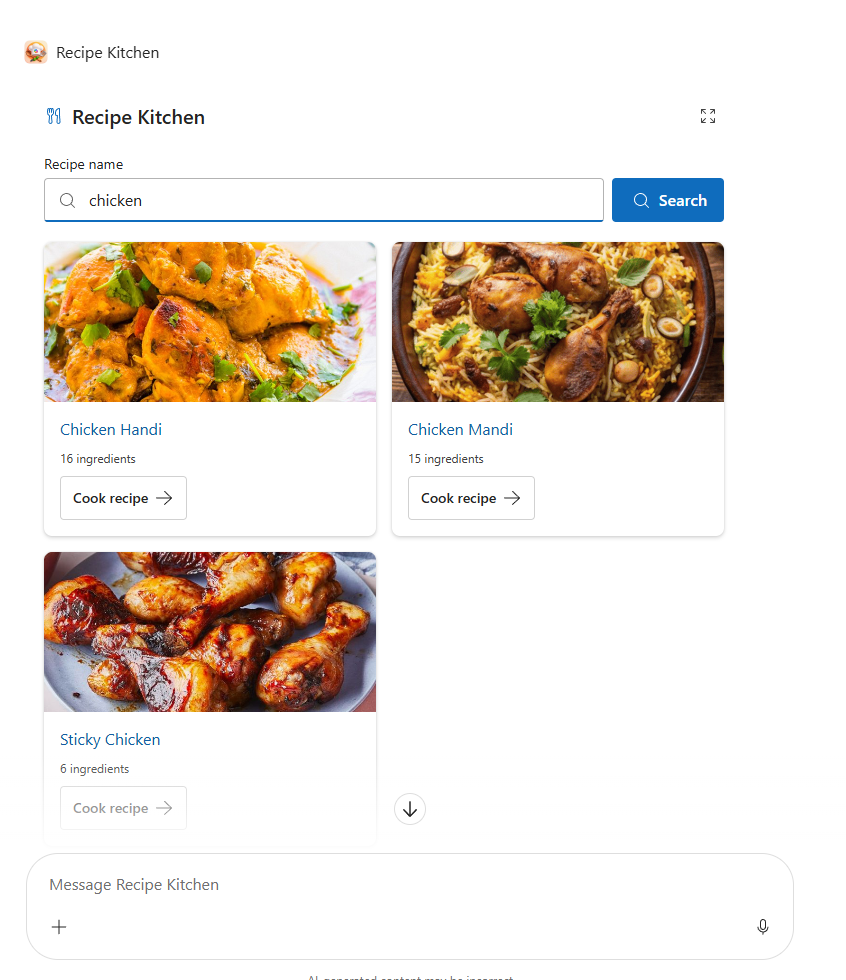
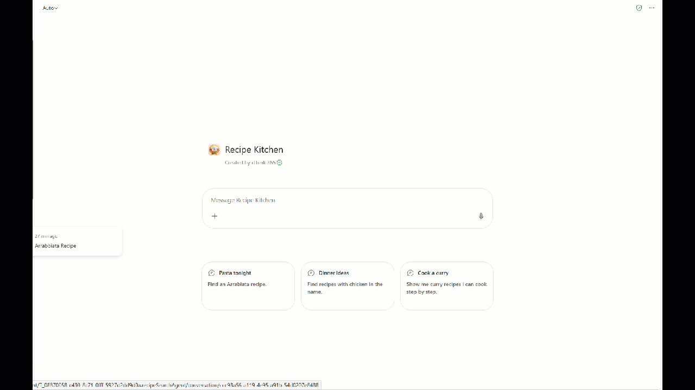

# Recipe Kitchen

## Summary

**Recipe Kitchen** is an internal, read-only recipe proof of concept built with an SPFx Copilot UX component and a generated declarative agent. 

It aims to help you find great recipes to help you wind down at the end of day and eat great food to improve your well being and energy.

The solution aims to allo you to have a provider-neutral recipe details in Microsoft 365 Copilot. TheMealDB is the packaged default provider; a deterministic mock provider is available for local debug sessions. This sample owns its component and agent package; the root Toolkit template does not build or package this solution.

## Screenshots

Please find some example screenshots of the experience,see how you can search for recipes.




This animated gif shows you how the kitchen works from searching for a recipe and choosing a recipe and see the ingredients and method to make the dish.



## Compatibility


## Applies to

- [SharePoint Framework](https://learn.microsoft.com/sharepoint/dev/spfx/sharepoint-framework-overview)
- [Microsoft Copilot extensibility](https://learn.microsoft.com/microsoft-365-copilot/extensibility/)
- [Microsoft 365 tenant](https://learn.microsoft.com/sharepoint/dev/spfx/set-up-your-development-environment)

## Contributors

- Simon Doy

## Version history

| Version | Date | Comments |
| ------- | ---- | -------- |
| 1.2.5.0 | 2026/11/03 | Current package version for the internal, read-only recipe proof of concept |

## Prerequisites

- **Node.js** `>=22.14.0 <23.0.0`, `>=24.0.0 <25.0.0`, or `>=26.0.0 <27.0.0`.
- **SharePoint Online tenant** with access to Copilot Workbench for local host testing. Deployment additionally requires access to the SharePoint app catalog and permission to sync the agent to Teams.
- **Heft** is installed locally by the project dependencies; install them with `npm ci`.
- The default TheMealDB provider uses its documented development API key `1`; no personal credentials are needed. Mock mode uses local data and images without network requests.

## Minimal Path to Awesome

Run these commands from this sample directory:

```powershell
npm ci
npm run build
npm start -- --nobrowser
```

Open [Copilot Workbench](https://[your sharepoint base url].sharepoint.com/_layouts/15/copilotworkbench.aspx). If prompted, allow the debug manifest at `https://localhost:4321/temp/build/manifests.js`, select **RecipeSearch**, and send a turn with:

```json
{ "query": "Arrabiata" }
```

If the HTTPS development certificate is not trusted, run `npx heft trust-dev-cert` from this directory and approve the operating-system trust prompt. Do not disable browser security or expose credentials.

For deterministic local testing without provider network requests, add `&recipeProvider=mock` to the Workbench URL while loading the debug manifest from `localhost`. Mock mode is ignored unless the `debugManifestsFile` points to `localhost`; TheMealDB remains the packaged default.

## Features

- **Dish-name search:** Searches for up to three matching recipes and checks each result through a full detail lookup.
- **Recipe details:** Preserves ingredient measures and the source's instruction lines. Users can select a result, check off ingredients and method steps, and navigate back to results.
- **Interactive presentation:** Supports theme and display-mode changes, narrow viewports, keyboard focus, and an image fallback.
- **Instance-only checklist state:** Check-off state belongs to the component instance, resets on a new search, and is not saved persistently.
- **Bounded, read-only requests:** Requests time out after 10 seconds, omit credentials, validate response structure, and report failures without logging search queries or dietary information. There is no caching or background retry behavior.

The proof of concept does not provide ingredient, cuisine, or time filters; serving scaling; verified dietary labels; or allergen safety certification. Missing quantities, structured units, servings, and preparation or cooking times remain unavailable when the source does not provide them.

## Data and Rights

The provider contract carries recipe source links, attribution, ingredients, instructions, and image permission status into the UI. The default TheMealDB adapter uses stable TheMealDB IDs and includes original source links only when they are valid HTTPS URLs. Provider attribution remains visible. TheMealDB images must use HTTPS URLs from `www.themealdb.com`; its host allowlist and rights mapping live in that adapter.

For the default TheMealDB development adapter, provider artwork without a third-party image source or restrictive rights flag may display under TheMealDB's documented development-use terms. Explicit Creative Commons confirmation is retained as a distinct permission basis and is not inferred when absent. Third-party artwork without separate permission, explicit negative rights flags, missing or unsafe image URLs, and broken images use placeholders. The mock provider uses original local illustrations and does not make image requests.

Review [TheMealDB terms](https://www.themealdb.com/terms_of_use.php), [API documentation](https://www.themealdb.com/api.php), and record-level rights before release. Development access is not production permission. Confirm production access, numerical quotas, distribution terms, and third-party content rights before deployment or redistribution.

## Architecture

```text
copilot/                                  Declarative agent and plugin manifests
	declarativeAgent.json                   Agent instructions and conversation starters
	ai-plugin.json                          Tool/plugin definition
	instruction.txt                         Agent instructions
	manifest.json                           Teams app manifest
src/copilotComponents/recipeSearch/
	RecipeSearchCopilotComponent.ts         SPFx Copilot component
	RecipeSearchCopilotComponentProperties.ts Tool parameter schema
	RecipeSearchView.tsx                    Recipe search and detail UI
	RecipeModels.ts                         Provider-neutral recipe and provider contracts
	RecipeProviderFactory.ts                Default and local-debug provider selection
	TheMealDbRecipeProvider.ts              TheMealDB API access, validation, and mapping
	MockRecipeProvider.ts                   Deterministic local sample recipes
	assets/mock-*.svg                       Original local mock illustrations
	*.test.ts                               Component, adapter, factory, and mock tests
config/package-solution.json              SPFx solution packaging configuration
sharepoint/solution/recipe-copilot-spfx.sppkg  Generated deployment package
teams/recipe-kitchen.zip                  Generated declarative agent package
```

## Testing & validation

`npm run build` runs TypeScript, lint, 37 Jest tests, production bundling, agent generation, and `.sppkg` packaging. The scaffold currently pins SPFx `1.24.0-rc.0` dependencies; verify supported release versions before wider deployment.

In Copilot Workbench, test source links, result selection, ingredient and method checklists, navigation back to results, theme and display-mode changes, narrow viewports, keyboard focus, and image fallback. DOM tests do not replace testing in the host or with assistive technology.

## Deployment Gate

The local build produces `sharepoint/solution/recipe-copilot-spfx.sppkg` and `teams/recipe-kitchen.zip`. Keep both generated artifacts; the `.sppkg` is the authoritative SharePoint deployment artifact. The packaged provider remains TheMealDB; mock mode requires the explicit localhost debug flag and is not a deployment setting. A local build does not deploy either package.

After hosted validation, upload the `.sppkg` to the SharePoint app catalog, enable tenant-wide availability, and use **Add to Teams** for the initial agent sync. Follow the [official Copilot app tutorial](https://learn.microsoft.com/sharepoint/dev/spfx/copilot/get-started/build-your-first-copilot-app), then verify natural-language discovery and tool invocation in Microsoft 365 Copilot.

WIQD was unavailable on PATH during implementation, so its validation and provisioning compatibility remain unproven. Do not let WIQD or the root Toolkit scaffold independently repackage this agent.

The initial dependency audit reported 13 vulnerabilities, including five high-severity findings. Triage them before release. Remaining release gates include hosted accessibility testing and evaluations, operational monitoring, support ownership, and rollback.

## Troubleshooting

| What you see | What helps |
| --- | --- |
| The local component is missing from Copilot Workbench | Confirm `npm start -- --nobrowser` is running and allow `https://localhost:4321/temp/build/manifests.js` when prompted. |
| The browser reports an untrusted HTTPS development certificate | Run `npx heft trust-dev-cert` and approve the operating-system trust prompt. Do not disable browser security. |
| A recipe image is missing | The image may have an unsafe or missing URL, a broken response, or rights that require the placeholder. |
| A generated package is missing or outdated | Run `npm run build` from this directory. The local build does not upload or sync packages. |

## Help

See the repository's [support guidance](../../SUPPORT.md) and [contribution guidelines](../../CONTRIBUTING.md) for questions or issue reports.

## Disclaimer

This sample is provided as-is. Review the repository [license](../../LICENSE), provider terms, and release gates before using or distributing it.