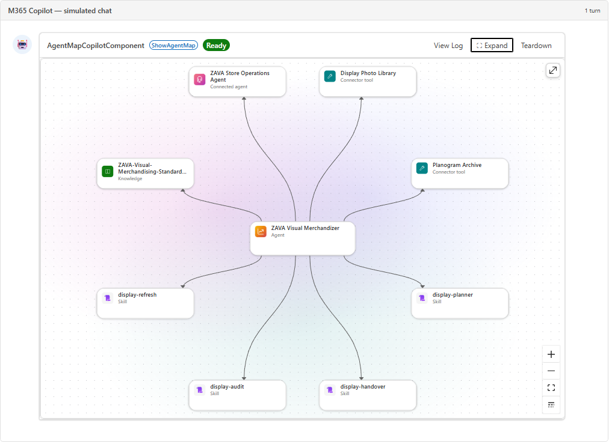
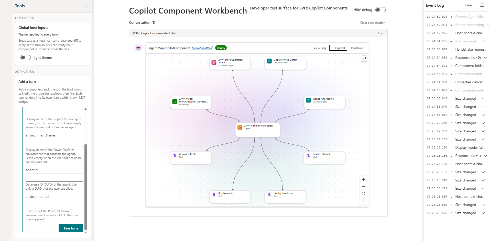

# Agent Map for Copilot Studio agents

## Summary

Agent Map shows how a Microsoft Copilot Studio agent is built, directly in Microsoft 365 Copilot. Ask the **Agent Map** agent to map an agent. An interactive graph shows the agent with its skills, tools, knowledge sources, connected agents, topics, triggers, and evaluation sets, and how they connect.

The sample is a SharePoint Framework (SPFx) Copilot UX component built with React, Fluent UI v9, and React Flow. It reads the agent definition from Dataverse with the signed-in user's delegated identity. It is read-only, and it needs no backend or Azure resources.

## Compatibility

## Applies to

- [SharePoint Framework](https://learn.microsoft.com/sharepoint/dev/spfx/sharepoint-framework-overview)
- [Microsoft Copilot extensibility](https://learn.microsoft.com/microsoft-365-copilot/extensibility/)
- [Microsoft 365 tenant](https://learn.microsoft.com/sharepoint/dev/spfx/set-up-your-development-environment)

> Get your own free development tenant by subscribing to the [Microsoft 365 developer program](https://aka.ms/m365/devprogram)

## Contributors

- [Ramakrishnan Raman](https://github.com/Ramakrishnan24689)

## Version history

| Version | Date | Comments |
| ------- | ---- | -------- |
| 1.0 | October 29, 2026 | Initial release |

## Prerequisites

- Microsoft 365 Copilot licenses for the users of the agent. Copilot UX components show only for licensed users.
- Copilot Studio agents that use the GitHub Copilot harness. The agent list shows only these agents. For other agents, the component tells the user that the agent does not use the GitHub Copilot harness.
- Read access to the agents in Dataverse (the `bot` and `botcomponent` tables). Makers who can edit an agent in Copilot Studio have this access.
- A SharePoint administrator who can deploy to the tenant app catalog.
- A Global Administrator to approve the **Dataverse** API access request. Only this role can approve permissions for Microsoft APIs. See [Manage access to Microsoft Entra ID-secured APIs](https://learn.microsoft.com/sharepoint/api-access).

## Minimal path to awesome

- Clone this repository (or [download this solution as a .ZIP file](https://pnp.github.io/download-partial/?url=https://github.com/pnp/spfx-copilot-components/tree/main/samples/copilot-studio-agent-map) then unzip it)
- From your command line, change your current directory to the directory containing this sample (`copilot-studio-agent-map`, located under `samples`)
- In the command line run:
  - `npm install`
  - `npm run build`
- Upload `sharepoint/solution/copilot-studio-agent-map.sppkg` to the tenant app catalog and select **Deploy**.
- In the SharePoint admin center, go to **Advanced** > **API access**, and approve the request for **Dataverse** `user_impersonation`. The component needs this permission in the workbench and in Microsoft 365 Copilot.
- To test the component in the Copilot Workbench:
  - Set the `SPFX_SERVE_TENANT_DOMAIN` environment variable to your SharePoint domain, for example `contoso.sharepoint.com`.
  - Run `npm run start`. It opens the workbench with the local debug manifests. You can also open `https://<your domain>/_layouts/15/CopilotWorkbench.aspx?debugManifestsFile=https://localhost:4321/temp/build/manifests.js&debug=true&noredir=true`.
  - In **Add a turn**, select **AgentMapCopilotComponent** and the **ShowAgentMap** tool, enter the properties if necessary, and select **Fire turn**.
- To use the agent, open Microsoft 365 Copilot, select the **Agent Map** agent, and use a conversation starter, for example *Show the agent map for [agent name]*.

## Features

The Agent Map view comes from the MCP App in the [Copilot Studio Kit](https://github.com/microsoft/Power-CAT-Copilot-Studio-Kit/tree/main/mcp-apps/copilot-agent-kit) (MIT License, Copyright (c) Microsoft Corporation). The import paths are different, the map shows Work IQ sources as one tool, and the map hides unknown items by default. Also, when a search matches the agent (for example, a word in its instructions), the map does not highlight all the components. The component supplies the MCP App host functions from the SPFx Copilot UX component APIs, so no MCP server is necessary.

- The inline card shows only the map. Full screen adds the environment and agent selectors, search, filters, the list, and the details of each item. While the component reads the agent from Dataverse, the card shows a loading indicator.
- Copilot fills in the optional tool properties `agentName`, `environmentName`, `agentId`, and `environmentId` from the user's request. A name matches when the case, the spaces, or the punctuation are different, and when a long name has a small spelling difference, for example *merchandiser* and *Merchandizer*. A name without the suffix *(default)* matches the default environment, for example *Contoso* and *Contoso (default)*. When no item or more than one item matches, the view shows a message and the selectors. The user chooses the missing values in the view.
- The three map tools (`show_agent_map`, `get_agent_map`, and `get_connected_agent_map`) run in the browser and validate their input with zod.
- The map includes connected agents and the skill references in inline and ZIP skill files. Secrets in skill text are redacted.
- Copilot Studio shows Work IQ as one tool on the **Build** tab. The map does the same: it shows the Work IQ sources of the agent (for example, calendar, files, and mail) as one **Work IQ** tool. The details panel shows each source and its access level.

This sample illustrates the following concepts:

- A Copilot UX component with `BaseCopilotComponent`, a tool `propertiesSchema` from zod, and a declarative agent
- Inline and full-screen display modes with `requestDisplayModeAsync` and `requestSizeChangeAsync`
- Delegated calls to the Dataverse Web API and the Global Discovery Service with `AadHttpClient` and `webApiPermissionRequests`
- An MCP App user interface that runs in a Copilot UX component

Limitations:

- The agent list shows the first 250 active agents of an environment.

## Troubleshooting

- **"Environment discovery is temporarily unavailable. Try again."** This message shows when the Global Discovery Service is not available, and also when the component cannot get a Dataverse token. Make sure that an administrator approved the **Dataverse** `user_impersonation` request in **SharePoint admin center** > **Advanced** > **API access**.
- **The API access request cannot be approved.** The `resource` value in `config/package-solution.json` must be the display name of the Dataverse service principal (application ID `00000007-0000-0000-c000-000000000000`) in your tenant. If the name in your tenant is **Dynamics CRM**, change `resource` to `Dynamics CRM`, and build and deploy the package again.
- **"You do not have access to this environment."** Dataverse security roles apply to the signed-in user. Make sure that the user can read the `bot` and `botcomponent` tables in the environment.
- **"No environment matches ..." or "More than one agent matches ..."** The component did not find one item with the name from the conversation. Small differences in case, punctuation, and spelling are not a problem, but a different name is. Choose the item in the view, or use the name that shows in Copilot Studio. The environment list has only the environments that the signed-in user can open in the tenant where Copilot runs. An environment in a different tenant is not in the list.
- **Some components are not in the map.** By default, the map hides evaluation sets, test cases, and unknown items. An unknown item is an agent component that the parser cannot read, or that has a YAML `kind` that the parser does not know. In full screen, the status line shows how many components the map shows and how many the agent has. To show the hidden items, select **Filters**, and then turn on **Evaluation sets**, **Test cases**, or **Unknown**. Unknown items are red. To see the kind and the reason for an unknown item, select the item. The details panel shows them. The **List** tab also shows the kind of each item.

## Help

We do not support samples, but this community is always willing to help, and we want to improve these samples. We use GitHub to track issues, which makes it easy for community members to volunteer their time and help resolve issues.

You can try looking at [issues related to this sample](https://github.com/pnp/spfx-copilot-components/issues) to see if anybody else is having the same issues.

If you encounter any issues using this sample, [create a new issue](https://github.com/pnp/spfx-copilot-components/issues/new).

## Disclaimer

**THIS CODE IS PROVIDED _AS IS_ WITHOUT WARRANTY OF ANY KIND, EITHER EXPRESS OR IMPLIED, INCLUDING ANY IMPLIED WARRANTIES OF FITNESS FOR A PARTICULAR PURPOSE, MERCHANTABILITY, OR NON-INFRINGEMENT.**

