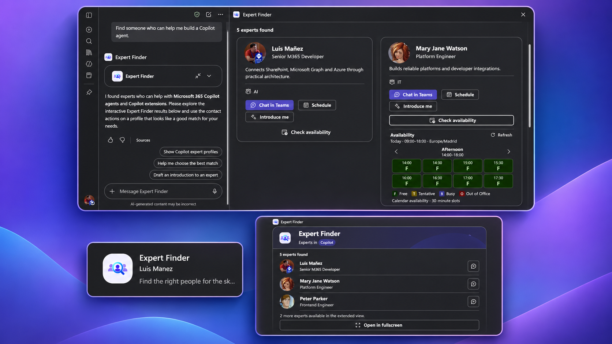
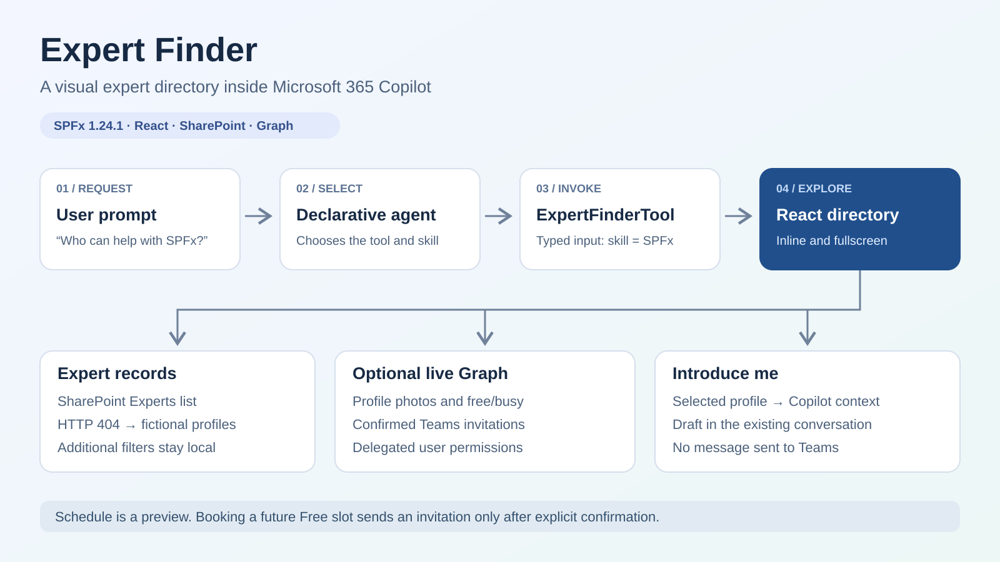

# Expert Finder

## Summary

Find colleagues by skill in Microsoft 365 Copilot, explore their profiles inline or in fullscreen, and connect through Microsoft Teams. This SharePoint Framework (SPFx) Copilot UX component reads an `Experts` list in SharePoint and uses delegated Microsoft Graph access for profile photos, calendar availability and confirmed Teams meetings.

When the list is absent, the same component runs with bundled fictional profiles and portraits. No custom backend or additional language model is required.





## Compatibility


The project uses React 18.3.1, TypeScript 5.8, Fluent UI v9, Zod and Heft. Node.js 24.x was used for development. See the [SPFx compatibility reference](https://learn.microsoft.com/en-us/sharepoint/dev/spfx/compatibility) for supported toolchain versions; keep the sample's existing dependencies.

## Applies to

- [SharePoint Framework](https://learn.microsoft.com/en-us/sharepoint/dev/spfx/sharepoint-framework-overview)
- [Copilot UX components](https://learn.microsoft.com/en-us/sharepoint/dev/spfx/copilot/overview-copilot-apps)
- SharePoint Online and Microsoft 365 Copilot

## Contributors

- [Luis Mañez](https://github.com/luismanez)

## Version history

| Version | Date | Comments |
| --- | --- | --- |
| 1.1 | November 7, 2026 | Added PnP PowerShell provisioning for the Experts list. |
| 1.0 | November 7, 2026 | Initial sample contribution, adapted from the Microsoft 365 Live 2026 community session. |

This table tracks the sample contribution. The SPFx solution and agent have separate [package versions](docs/deployment.md#updating-the-sample).

## Prerequisites

- Node.js 24.x and npm, with an [SPFx development environment](https://learn.microsoft.com/en-us/sharepoint/dev/spfx/set-up-your-development-environment) and a trusted local HTTPS development certificate.
- A Microsoft 365 development tenant with SharePoint Online, a tenant App Catalog and administrator access for deployment.
- A Microsoft 365 Copilot add-on license for the user testing the component, including in Copilot Workbench. Check the current [licensing and client requirements](https://learn.microsoft.com/en-us/sharepoint/dev/spfx/copilot/overview-copilot-apps) before deployment.
- For live data: an `Experts` list in the tenant root site and permission for the signed-in user to read it. Use the [PnP PowerShell provisioning script](scripts/Provision-ExpertsList.ps1), following the [SharePoint setup guide](docs/sharepoint-setup.md#create-the-list-with-pnp-powershell), or create the schema manually.
- For live photos and calendars: the [delegated Graph permissions](docs/graph-permissions.md). Calendar features also require accessible Exchange mailboxes; meeting creation requires Teams support in the organizer's calendar.

Mock profiles need no Graph consent. The component still checks SharePoint to select its data source, and **Introduce me** uses the Copilot host.

## Minimal path to awesome

1. Clone this repository or [download this sample](https://pnp.github.io/download-partial/?url=https://github.com/pnp/spfx-copilot-components/tree/main/samples/expert-finder).
2. From the repository root, open the SPFx project:

   ```bash
   cd samples/expert-finder/src/copilot-expert-finder
   npm install
   npm start -- --nobrowser
   ```

   If using the sample-only download, open its `src/copilot-expert-finder` directory instead.

3. Open `https://YOUR-TENANT.sharepoint.com/_layouts/15/copilotworkbench.aspx` and load the local manifests from `https://localhost:4321/temp/build/manifests.js` when prompted. Select **ExpertFinderTool** and supply `{"skill":"SPFx"}`.
4. If the tenant root has no `Experts` list and SharePoint returns HTTP 404, the component uses fictional data. To use tenant users, provision the list with the [PnP PowerShell script](docs/sharepoint-setup.md#create-the-list-with-pnp-powershell), add expert records and arrange any [Graph permissions](docs/graph-permissions.md) needed for photos or calendars, then reload the component.
5. Stop the development server and build the production package:

   ```bash
   npm run build
   ```

6. Follow [deployment](docs/deployment.md) to upload `sharepoint/solution/copilot-expert-finder.sppkg` to the App Catalog, enable it and synchronize the agent with **Add to Teams**. Open the agent in Copilot and ask **Who can help me with SPFx?**

The build script already includes production bundling and packaging. Workbench checks the component with supplied arguments; the deployed agent is needed to check natural-language tool selection and introduction drafts in conversation.

## Features

- Typed tool input for the canonical skills `SPFx`, `Copilot`, `DB` and `Spanish`.
- Inline results with the total count, up to three experts and host-supported fullscreen expansion.
- Responsive fullscreen cards with local name-prefix, department and job-title filters, plus light and dark themes.
- SharePoint data access through `SPHttpClient` using the signed-in user's permissions. The list uses a single-choice `Skill` column; a person can have separate records for different skills.
- Parallel profile-photo loading with shimmer, per-instance caching and initials on failure.
- On-demand calendar availability for today, 09:00–18:00 in the viewer's local time, in 30-minute slots. Morning/Afternoon navigation reuses the loaded result.
- User-confirmed Teams meetings from future Free slots, with both-calendar checks and duplicate-request protection.
- **Introduce me**, which shares only the selected professional profile with Copilot and requests a first-person draft containing exactly three relevant questions.

### Preview actions and real operations

| Action | Fictional profiles | SharePoint profiles |
| --- | --- | --- |
| Search and filters | Bundled profiles; filters run locally | SharePoint filters by skill; additional filters run locally |
| **Chat in Teams** | Contact preview | Opens a Teams chat; sends no message automatically |
| **Schedule** | Preview dialog | Preview dialog; creates no meeting |
| **Check availability** | Explains that fictional profiles have no calendar | Reads the selected expert's free/busy availability |
| Select a future Free slot | Unavailable | Opens a confirmation; **Create Teams meeting** creates an event and sends a real invitation |
| **Introduce me** | Illustrative draft for a fictional person | Draft grounded in the selected profile; sends nothing to Teams |

### Data source and limits

The component checks `Experts` in the tenant root site once during initialization. HTTP 200 selects SharePoint; HTTP 404 selects mocks. Other errors are shown instead of being hidden by a fallback. An existing list without matching records shows an empty state. No tenant URL needs to be edited in the source.

Mock result counts are SPFx **6**, Copilot **8**, DB **1** and Spanish **0**. The SharePoint provider supports up to 100 records per skill and reports an error if more pages are returned. Calendar navigation covers today only. Successful bookings remain marked Busy for the component session; this does not establish attendee acceptance or track later Outlook changes.

## Documentation

- [Build, local development and deployment](docs/deployment.md)
- [Experts list provisioning, schema and manual sample data](docs/sharepoint-setup.md)
- [Graph permissions with CLI for Microsoft 365](docs/graph-permissions.md)
- [Copilot prompts and introduction drafting](docs/copilot-invocation.md)
- [Code walkthrough](docs/code-walkthrough.md)
- [Manual validation checklist and reported host checks](docs/validation.md)
- [Image provenance and redistribution](assets/README.md)

## Help

These are community samples. Search the [repository issues](https://github.com/pnp/spfx-copilot-components/issues) for related reports, or [create an issue](https://github.com/pnp/spfx-copilot-components/issues/new) with the sample name, steps to reproduce and relevant environment details.

## License

This sample is provided under the repository's [MIT license](../../LICENSE). See [image provenance](assets/README.md) for the bundled visual assets.

## Disclaimer

**THIS CODE IS PROVIDED _AS IS_ WITHOUT WARRANTY OF ANY KIND, EITHER EXPRESS OR IMPLIED, INCLUDING ANY IMPLIED WARRANTIES OF FITNESS FOR A PARTICULAR PURPOSE, MERCHANTABILITY, OR NON-INFRINGEMENT.**


