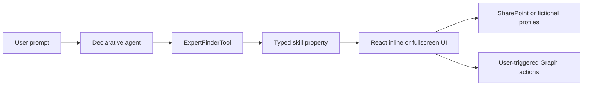

# Code walkthrough

Code and configuration paths are relative to [`src/copilot-expert-finder`](../src/copilot-expert-finder/). This guide describes the existing implementation; it does not require a backend, another model or a separate MCP server.

## Request flow

Copilot selects the tool and generates its arguments. The component validates the canonical skill, retrieves matching records and renders the interactive results. It does not ask another model to search. Supported skills are `SPFx`, `Copilot`, `DB` and `Spanish`; local filters refine the results of the current invocation.

## Agent and component wiring

| File | Responsibility |
| --- | --- |
| [copilot/manifest.json](../src/copilot-expert-finder/copilot/manifest.json) | Microsoft 365 app identity, branding and baseline agent reference |
| [copilot/declarativeAgent.json](../src/copilot-expert-finder/copilot/declarativeAgent.json) and [instruction.txt](../src/copilot-expert-finder/copilot/instruction.txt) | Agent description, starters, skill mappings and drafting rules |
| [copilot/ai-plugin.json](../src/copilot-expert-finder/copilot/ai-plugin.json) | Plugin seed; the build expands the runtime wiring |
| [config/copilot-agent.json](../src/copilot-expert-finder/config/copilot-agent.json) | Groups the component into the agent |
| [Component manifest](../src/copilot-expert-finder/src/copilotComponents/expertFinder/ExpertFinderCopilotComponent.manifest.json) and [typed properties](../src/copilot-expert-finder/src/copilotComponents/expertFinder/ExpertFinderCopilotComponentProperties.ts) | Tool metadata and Zod-backed input contract |
| [ExpertFinderCopilotComponent.tsx](../src/copilot-expert-finder/src/copilotComponents/expertFinder/ExpertFinderCopilotComponent.tsx) | SPFx context, source selection, service lifetime, React rendering and public Copilot Bridge calls |

SPFx hosts the component and supplies managed runtime tool discovery. Preserve package identities when updating an existing installation. See [deployment](deployment.md) for when agent synchronization is required.

## Data and React views

[createExpertService.ts](../src/copilot-expert-finder/src/copilotComponents/expertFinder/services/createExpertService.ts) checks `Experts` at the origin of the SPFx context URL. HTTP 200 selects SharePoint, HTTP 404 selects mocks and other failures remain errors. An empty existing list is not a reason to use mocks.

[SharePointExpertService.ts](../src/copilot-expert-finder/src/copilotComponents/expertFinder/services/SharePointExpertService.ts) uses `SPHttpClient` under the current user's permissions, filters the single-choice `Skill` column server-side, expands the Person field and validates the response with Zod. It reports an error if the result exceeds one page of 100 records. Membership login and SMTP email have distinct roles: UPN-based photos/Teams links and email-based calendar requests.

[MockExpertService.ts](../src/copilot-expert-finder/src/copilotComponents/expertFinder/services/MockExpertService.ts) reads the bundled [mockExperts.ts](../src/copilot-expert-finder/src/copilotComponents/expertFinder/data/mockExperts.ts). The JSON under `docs/` is only a manual SharePoint setup aid. Mock mode does not construct the live Graph services.

| Component | Responsibility |
| --- | --- |
| [ExpertFinder.tsx](../src/copilot-expert-finder/src/copilotComponents/expertFinder/components/ExpertFinder.tsx) | Loads results and coordinates shared interaction state |
| [ExpertFinderInline.tsx](../src/copilot-expert-finder/src/copilotComponents/expertFinder/components/ExpertFinderInline.tsx) | Total count, up to three experts and host-supported expansion |
| [ExpertFinderFullscreen.tsx](../src/copilot-expert-finder/src/copilotComponents/expertFinder/components/ExpertFinderFullscreen.tsx) | Responsive cards and local name-prefix, department and job-title filters |
| [ExpertCard.tsx](../src/copilot-expert-finder/src/copilotComponents/expertFinder/components/ExpertCard.tsx) and [ExpertActions.tsx](../src/copilot-expert-finder/src/copilotComponents/expertFinder/components/ExpertActions.tsx) | Profile presentation and user actions |
| [ExpertAvailabilityPanel.tsx](../src/copilot-expert-finder/src/copilotComponents/expertFinder/components/ExpertAvailabilityPanel.tsx) | One selected expert's availability and bookable slots |
| [MeetingConfirmationDialog.tsx](../src/copilot-expert-finder/src/copilotComponents/expertFinder/components/MeetingConfirmationDialog.tsx) | Explicit confirmation before a real calendar write |

Filters operate in memory. Host theme and display-mode changes do not trigger another model call. Teams navigation uses the public host link API; **Schedule** remains a preview dialog.

## Graph photos and calendars

[GraphPhotoService.ts](../src/copilot-expert-finder/src/copilotComponents/expertFinder/services/GraphPhotoService.ts) uses `MSGraphClientV3` to retrieve photo bytes, loads the small result set in parallel and caches by UPN for the component instance. Avatars show a shimmer and fall back to initials. The service releases Blob URLs on teardown.

[GraphAvailabilityService.ts](../src/copilot-expert-finder/src/copilotComponents/expertFinder/services/GraphAvailabilityService.ts) requests only the selected expert's SMTP address using `POST /me/calendar/getSchedule`. Today's local 09:00–18:00 boundaries are converted to UTC, and the returned half-hour availability codes are displayed in local time. Event details are discarded. Morning/Afternoon navigation slices the loaded day, while **Refresh** makes a new request; there is no background calendar polling.

[GraphMeetingService.ts](../src/copilot-expert-finder/src/copilotComponents/expertFinder/services/GraphMeetingService.ts) rechecks both calendars and the organizer's Teams-provider support after confirmation, then creates a calendar-backed event with `isOnlineMeeting: true` and `onlineMeetingProvider: teamsForBusiness`. This sends a real invitation. The service blocks self-booking and repeated in-flight attempts and uses Graph's `transactionId` for retry protection.

Successful creation adds a session-local Busy record that takes precedence over stale Free results. It survives expert/mode changes in the component instance, but not a reload, and does not establish attendee acceptance or track later cancellations. An uncertain create result blocks another attempt for that slot in the instance: inspect Outlook before retrying. A missing join link can be reread from the created event without creating another meeting.

See [Graph permissions](graph-permissions.md) for delegated consent and mailbox prerequisites.

## Selected-profile context and follow-up

**Introduce me** is a component action, not a new tool. [introduction.ts](../src/copilot-expert-finder/src/copilotComponents/expertFinder/utils/introduction.ts) builds a context snapshot with `purpose: introductionDraft`, a fictional-profile marker and exactly one expert's name, job title, department, skill and summary. It excludes emails, photos, calendar data and other experts, and rejects payloads over its 9,000-byte UTF-8 budget.

The entry point:

1. Creates host text content using a descriptive data label and the profile JSON.
2. Awaits `updateModelContextAsync` to publish that selected profile.
3. Calls `sendFollowUpMessageAsync` with the drafting request.
4. Checks `isError`, handles timeout/cancellation and releases the shared pending state.

Profile fields remain untrusted data. Behavioral rules belong in the agent and follow-up. A shared guard prevents overlapping requests from different cards. The host returns an acknowledgement, while the draft appears in the Copilot conversation; the component contains no draft editor and sends no Teams message. See [invocation](copilot-invocation.md) for expected draft content and [Microsoft's context guidance](https://learn.microsoft.com/en-us/sharepoint/dev/spfx/copilot/provide-context-to-copilot) for the public Bridge APIs.
