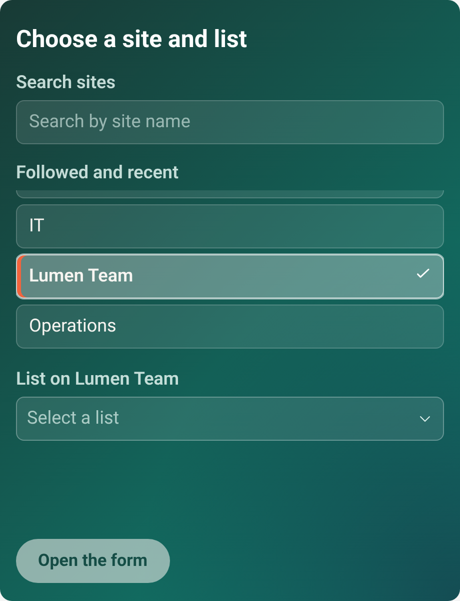
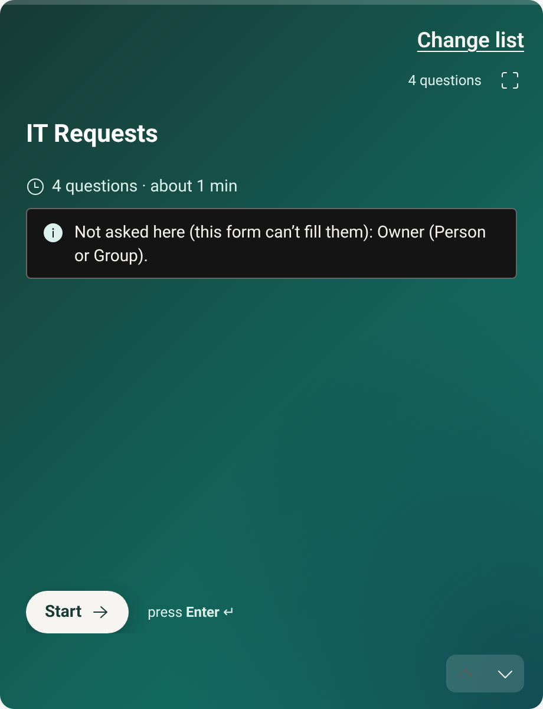
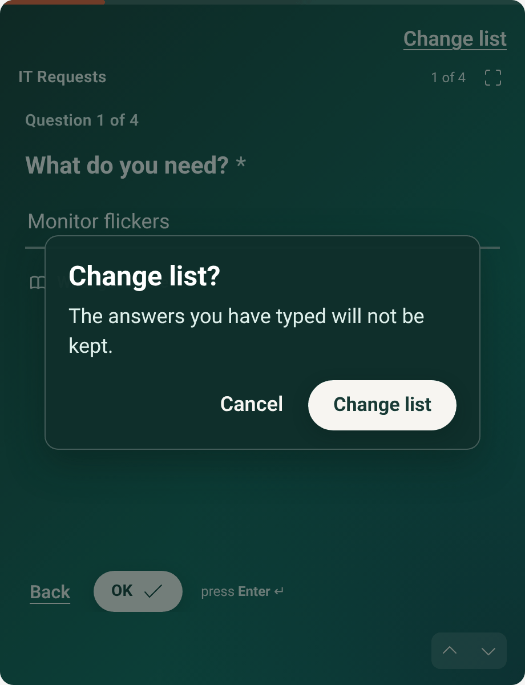
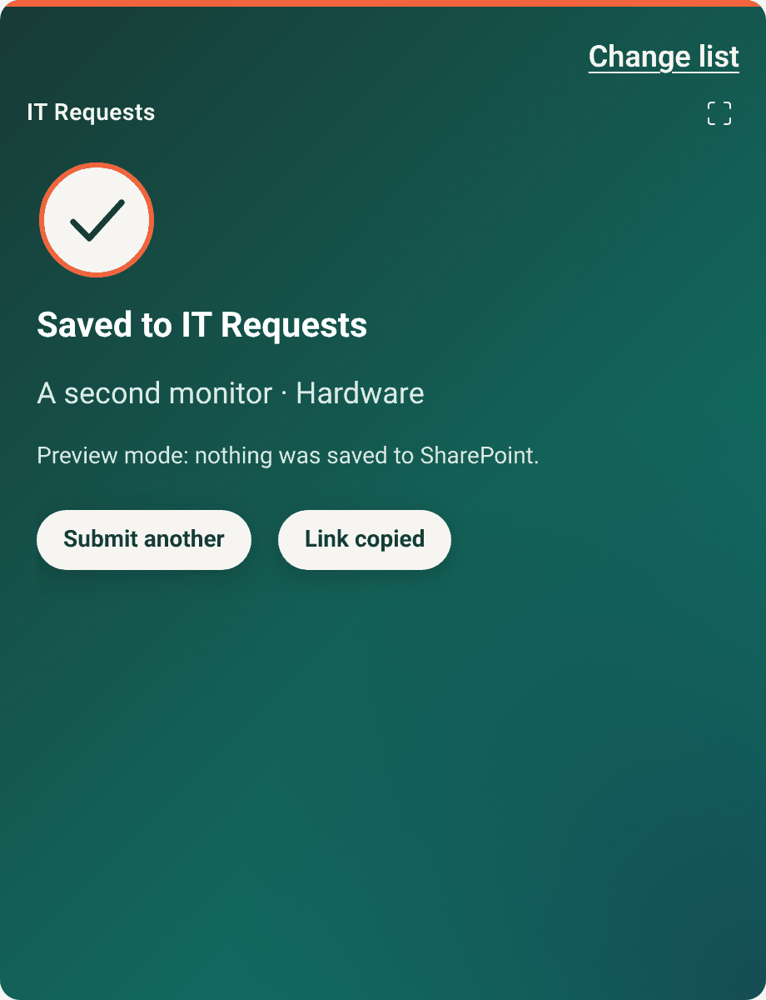
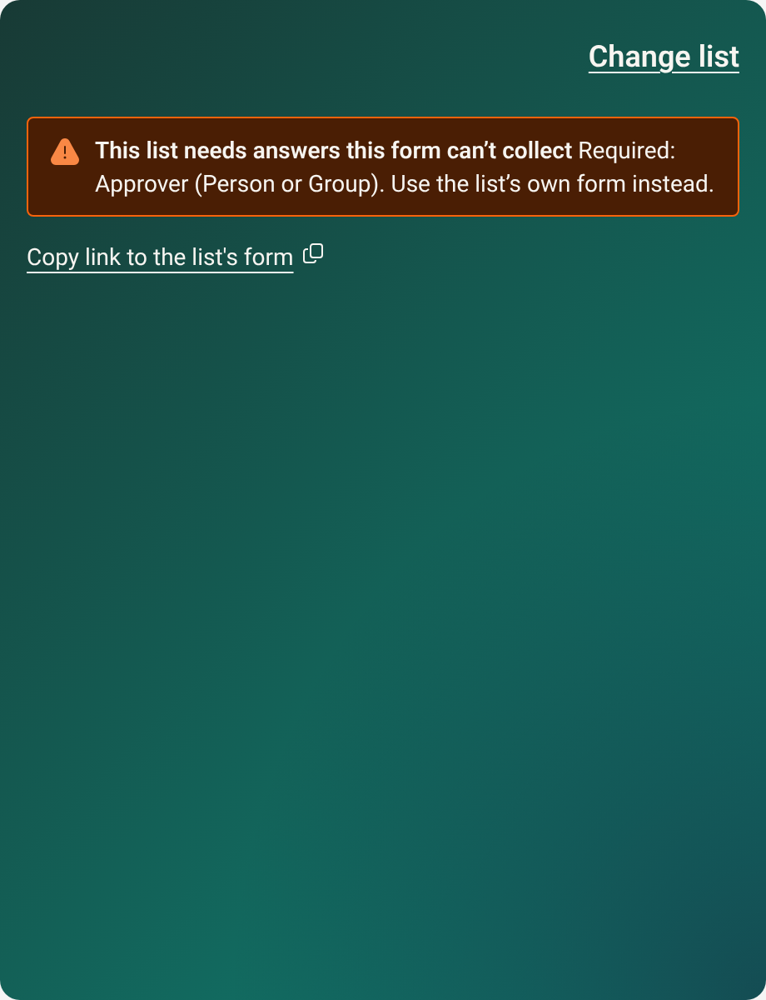
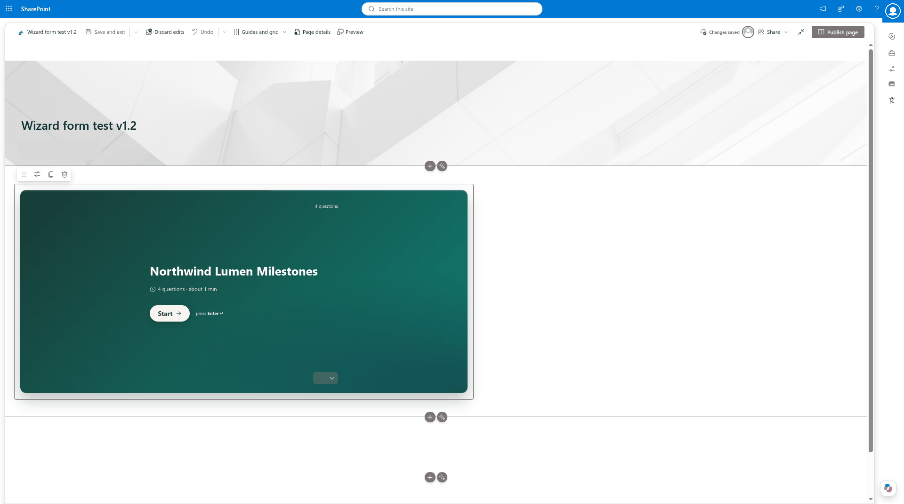
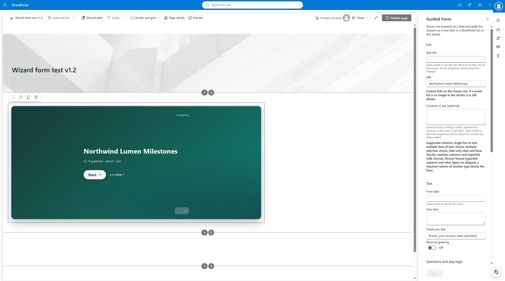
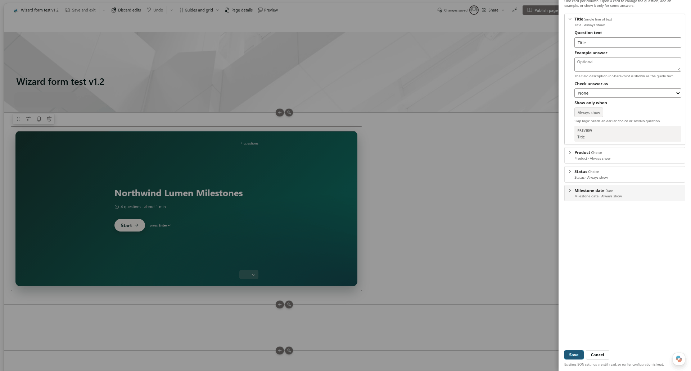

# Guided List Form

## Summary

A conversational, one-question-at-a-time form that creates **one item in one SharePoint custom list**. One SharePoint Framework 1.24 solution ships the same wizard in two hosts:

- **SharePoint page web part.** A page author picks a site, a custom list and the fields in the property pane, and visitors fill in the form on the page.
- **Microsoft 365 Copilot UX component.** The tool is `open_step_by_step_form`. Copilot opens the form inline and can prefill answers from the conversation. The person always reviews and submits the form themselves; Copilot can never submit.

When Copilot does not name a list, or the list cannot be opened, the card shows a site and list picker. After a successful submit in Copilot, **Copy link to item** copies the new item's address to the clipboard. **Change list** returns to the in-card picker.

## Compatibility

-Incompatible-red.svg)

## Applies to

- [SharePoint Framework](https://learn.microsoft.com/sharepoint/dev/spfx/sharepoint-framework-overview)
- [Microsoft Copilot extensibility](https://learn.microsoft.com/microsoft-365-copilot/extensibility/)
- [Microsoft 365 tenant](https://learn.microsoft.com/sharepoint/dev/spfx/set-up-your-development-environment)

> Get your own development tenant by subscribing to the [Microsoft 365 developer program](https://aka.ms/m365/devprogram)

## Contributors

- [Anand Vijayaragavan](https://github.com/anandragav)

## Version history

| Version | Date              | Comments        |
| ------- | ----------------- | --------------- |
| 1.0     | November 24, 2026 | Initial release |

The packaged solution version in `config/package-solution.json` is `1.4.6.1`.

## Prerequisites

- A SharePoint Online tenant and permission to deploy to the **tenant App Catalog**. Deploy the package with **Make this solution available to all sites in the organization**, then select **Add to Teams** (or **Sync to Teams**) so the Copilot host can find the component.
- At least one **custom list** (template 100) that you can add items to. Person, lookup, managed metadata and picture columns cannot be filled by this form; if a required column is one of those types, the form explains that and offers a copy link to the list's own form.
- For the Copilot experience, a **Microsoft 365 Copilot license** for each person who uses the agent.
- No API permissions or admin consent: the web part and the Copilot component call SharePoint REST as the signed-in user.

## Minimal path to awesome

- Clone this repository (or [download this solution as a .ZIP file](https://pnp.github.io/download-partial/?url=https://github.com/pnp/spfx-copilot-components/tree/main/samples/guided-list-form) then unzip it)
- From your command line, change your current directory to the directory containing this sample (`guided-list-form`, located under `samples`)
- In the command line run:
 - `npm install`
 - `npm run build` (runs the unit tests and creates `sharepoint/solution/copilot-wizard-form.sppkg`)
- Upload `sharepoint/solution/copilot-wizard-form.sppkg` to the tenant App Catalog and deploy it. Tick **Make this solution available to all sites in the organization**.
- For Copilot: in the App Catalog, select the app and select **Add to Teams** (or **Sync to Teams**). Wait a few minutes, then start a fresh Copilot chat.
- In Microsoft 365 Copilot, open **Guided Form** from the agents list and ask "Open a list form" or "Help me fill in a SharePoint list form". Pick a site and a custom list, then select **Open the form**.
- Optionally, add the **Guided Form** web part to a SharePoint page, choose a list in the property pane, and publish the page.

`npm test` runs the same unit tests without packaging the `.sppkg`.

## Features

- **One question per screen.** The wizard asks the supported columns of a custom list one at a time, with a review step before submit and a finish screen after a new item is added.
- **Site and list picker in Copilot.** Followed and recent sites, plus a name search on the current tenant only, then a dropdown of visible custom lists. The current site is labelled with its real title in Copilot; **This site** is used only when the web part is on a SharePoint page. The primary button is **Open the form**.
- **Change list.** In Copilot, **Change list** returns to the in-card picker without a reload. If answers have been typed, a confirm step warns that they will not be kept.
- **Copy link.** After a successful submit in Copilot, **Copy link to item** (and **Copy link to the list's form** when the list cannot be filled) copies a same-tenant https address to the clipboard. On a SharePoint page those controls stay ordinary links.
- **Prefill from the conversation.** Copilot may pass answers as a JSON object keyed by column name. The person can change every value. Copilot never submits the form and is told only a status (opened, submitted, not submitted, or not confirmed yet), never the answers or item content.
- **Supported columns.** Single line of text, multiple lines of text, choice and multi-choice, Yes/No, number, currency, date, date and time, and URL-format hyperlink (`https://` only). Optional unsupported columns are skipped; a required unsupported column blocks the form with a clear message.
- **Question editor.** On the page web part, **Customize questions** opens a side panel for question text, examples, skip logic and answer checks, written back to the existing JSON properties.
- **Submit stays honest.** A save that takes longer than about 20 seconds is treated as unconfirmed, not as a failed submit. The form keeps the original request, moves to saved if a late response arrives, and offers **Check if saved** before a new save is allowed. SharePoint field validation messages are shown. Empty required answers are blocked before a request is sent. After a successful save, Copilot's model context is updated to `submitted` so it does not keep saying the form is still open.
- **Look and accessibility.** A full-bleed forest-to-teal gradient panel, cream action pills, keyboard support, a live region for each new question, and motion that turns off with **Animations off** or the system's reduced-motion setting. An optional accent colour tints the gradient; white text stays readable.

This sample illustrates the following concepts:

- One React UI shared by a web part (`BaseClientSideWebPart`) and a Copilot UX component (`BaseCopilotComponent`), with the web part limited to `supportedHosts: ["SharePointWebPart"]`
- Packaging a declarative agent and an API plugin inside the `.sppkg` with `toolDiscovery: static` and the tool `open_step_by_step_form`
- Validating model-supplied site URLs (https, same tenant, no credentials) before any SharePoint call
- Sending only status text back to the model, never form answers or list item content
- A zero-permission component that reads and writes SharePoint lists as the signed-in user

## Security

- **No API permissions.** The package requests no `webApiPermissionRequests` and calls only SharePoint REST on the same tenant, as the signed-in user.
- Model-supplied site URLs must be `https` on the current tenant, with no credentials. Anything else is rejected.
- No raw HTML is rendered. Copilot gets back status text only (opened, submitted, not submitted, or not confirmed yet, with a short reason on failure). Answers and item content are never sent to the model.
- Hyperlink values accept only `https://` URLs. `http://`, `javascript:`, `data:` and URLs that contain a username or password are rejected.

## Screenshots

The first five screenshots are from the local preview with demo data (Contoso-style site names such as Lumen Team and IT Requests). Nothing was saved to a real tenant. The finish screen still shows the preview-mode note for that reason. The last three show the web part on a SharePoint site page, with the property pane and the Customize questions editor. Account and author details are masked.

The site and list picker, with a site selected and **Open the form**.

The welcome card for a list, with **Change list** and a note about a column the form cannot fill.

Confirming **Change list** after an answer has been typed.

The finish screen after a successful submit, with **Link copied**.

A list the form cannot fill, with **Copy link to the list's form**.

The web part on a SharePoint site page, on the welcome card for a list.

The web part property pane, with the list selected and the Site URL field left empty so the form uses the current site.

The Customize questions editor, with the Title card open and Save and Cancel at the bottom.

## Help

We do not support samples, but this community is always willing to help, and we want to improve these samples. We use GitHub to track issues, which makes it easy for community members to volunteer their time and help resolve issues.

You can try looking at [issues related to this sample](https://github.com/pnp/spfx-copilot-components/issues) to see if anybody else is having the same issues.

If you encounter any issues using this sample, [create a new issue](https://github.com/pnp/spfx-copilot-components/issues/new).

## Disclaimer

**THIS CODE IS PROVIDED _AS IS_ WITHOUT WARRANTY OF ANY KIND, EITHER EXPRESS OR IMPLIED, INCLUDING ANY IMPLIED WARRANTIES OF FITNESS FOR A PARTICULAR PURPOSE, MERCHANTABILITY, OR NON-INFRINGEMENT.**

