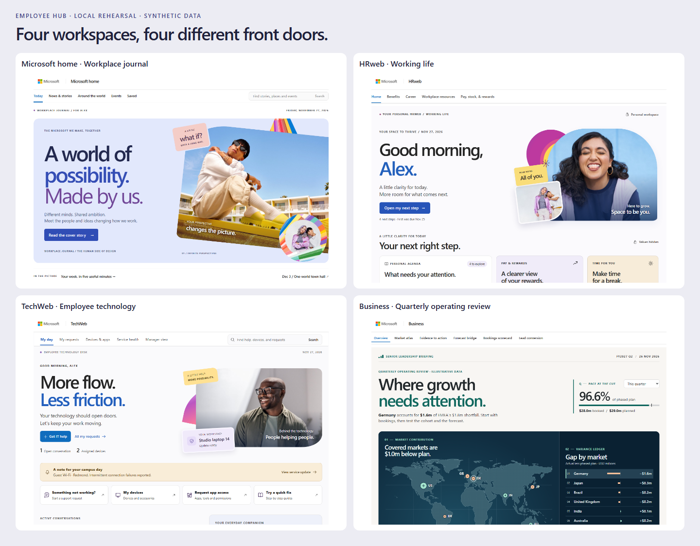
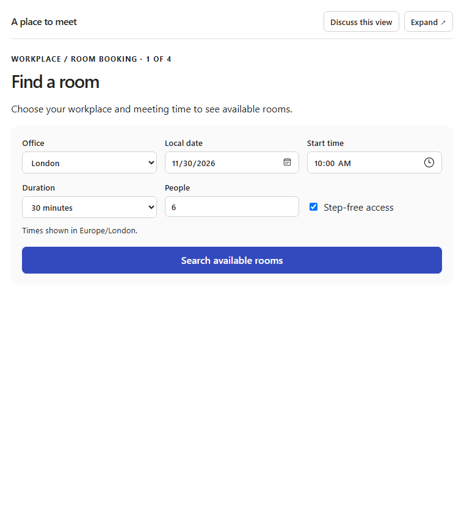
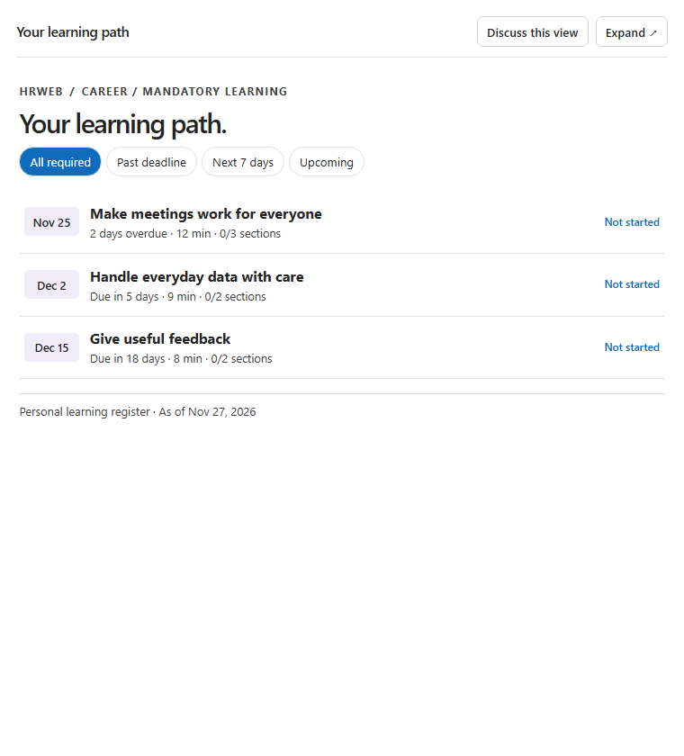
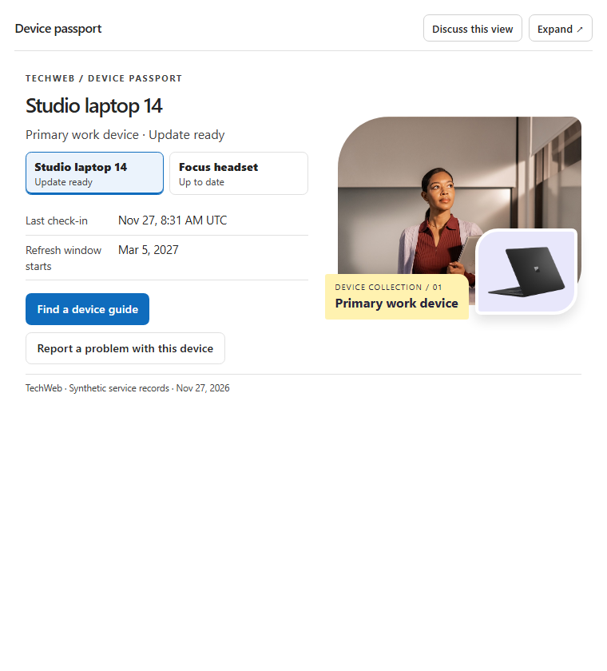
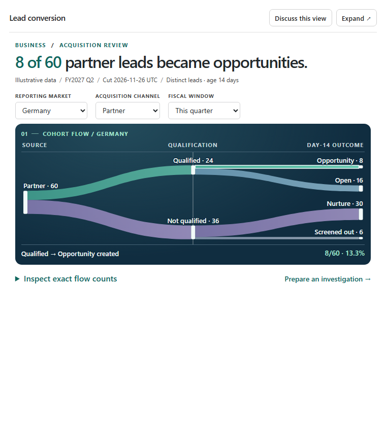

# Microsoft Employee Hub

Ask how German partner leads converted this quarter. Change **Partner** to **Inbound**, and the chart, exact counts and denominator change together. Expand the selected ribbon into Business, prepare a follow-up against that very cut and confirm one session action. The action changes the register, not the historical report.

Employee Hub is an SPFx **1.24.2** sample with four authored workspaces: **Microsoft home**, **HRweb**, **TechWeb** and **Business**. The first is a workplace journal, the second is a personal service desk for working life, the third follows devices and support conversations, and the fourth is a commercial operating review. The employee portals use supplied Microsoft campaign photography and the official light/dark wordmarks. **The contributor confirmed rights on 2026-11-28 to use and redistribute the supplied assets with this sample, including source, packages, screenshots and recordings.** This does not establish publisher verification or tenant deployment approval. Business figures and employee records are fictional; campaign subjects are not identified as those employees.

## Screenshots



**Open a full-size screenshot:** [Microsoft home](review/evidence/screens/company-1280.png) · [HRweb](review/evidence/screens/hr-1280.png) · [TechWeb](review/evidence/screens/tech-1280.png) · [Business](review/evidence/screens/business-1280.png) · [inline lead conversion](review/evidence/screens/task-09-inline-760.png). These same five PNGs are embedded in the locally built `sharepoint\solution\ms-employee-hub.sppkg` as App Catalog screenshots. They are captures of the running local sample with synthetic data, not signed-in host screenshots.

For more views, see [all four phone layouts](review/evidence/workspace-phone.png) and the [30-component inline gallery](review/evidence/inline-gallery.html). No installation is needed to open the PNGs.

## Inline components and example prompts

**[Browse all 30 inline components and their example prompts](Employee-Hub-Demo-Prompts.md#inline-component-and-prompt-index).** Each entry pairs the component name with a prompt you can copy, the one tool expected to open, and a screenshot. Here are four examples from the local sample:

<!-- inline-examples -->
| #04 A place to meet | #10 Your learning path |
| --- | --- |
| Find a step-free room in London for six.<br>`BookMeetingRoom` | What learning is due next?<br>`ShowRequiredLearning` |
|  |  |

| #19 Device passport | #09 Lead conversion |
| --- | --- |
| Does my assigned laptop need attention?<br>`InspectMyDevice` | How many partner leads in Germany became opportunities this quarter?<br>`TraceLeadConversion` |
|  |  |
<!-- /inline-examples -->

## Teams packages and Cowork plug-in

| What you want | Where to start | PowerShell from the sample root |
|---|---|---|
| Teams personal apps | [Teams packaging guide and five ZIPs](teams/README.md). Choose the all-up Employee Hub, Microsoft home, HRweb, TechWeb or Business. Each is a separate personal tab, not a Copilot agent. | `.\teams\Package-TeamsApps.ps1` for all five; `.\teams\hr\Package-App.ps1` for just HRweb. Add `-Check` for read-only verification. |
| Copilot Cowork plug-in | [Manual plug-in setup](employee-hub-plugin/README.md). Three JSON manifests and two icons connect Cowork and its included agent to the deployed Employee Hub solution. No Agents Toolkit. | `.\employee-hub-plugin\Package-Plugin.ps1 -Review` builds the [inspection ZIP](employee-hub-plugin/employee-hub-local-review.zip). Use the guide's tenant and publisher parameters for a pilot. |

The top-level [teams/employee-hub.zip](teams/employee-hub.zip) is the **embedded SPFx Copilot agent**, not a Teams personal app or the Cowork plug-in. The default packages use review-only publisher settings; use the [pilot guide](docs/pilot-install.md) before installation.

## Review it locally

**Build the local review package:** run `npm run review:candidate` to create `sharepoint\solution\ms-employee-hub.sppkg`. Generated SPFx solutions are not checked into the repository. The [restricted pilot instructions](docs/pilot-install.md) describe how to build a tenant-configured set. Do not install the placeholder distribution in a tenant.

<!-- release-fingerprint -->
SPFx **1.0.0.2**, 3,180,822 bytes; SHA-256 `051cf8f450d640df4f8b9cb4c0f33fc3e416922aba2121cadab43147cf2664ac`. 30 Copilot tools, 34 web parts, five personal Teams apps and one separate Cowork plug-in. [Package fingerprints and evidence](assets/release-evidence.json).
<!-- /release-fingerprint -->

Use **Node 26.13.0** for the recorded setup. From this sample directory:

```powershell
npm ci
npm run review
```

Open **http://127.0.0.1:4330**. The studio renders the actual React bodies, without a tenant, sign-in or remote media. The toolbar changes entry, content width, display mode, theme and **synthetic fixture**, not real permissions. **Reset session** clears the in-memory overlay. For an offline handoff, `npm run review:build` creates a self-contained `.review-build\index.html` that can be opened in Edge or Chrome without starting a server.

Open [Microsoft home](http://127.0.0.1:4330/?entry=30&landing=company&mode=full), [HRweb](http://127.0.0.1:4330/?entry=30&landing=hr&mode=full), [TechWeb](http://127.0.0.1:4330/?entry=30&landing=tech&mode=full) or [Business](http://127.0.0.1:4330/?entry=30&landing=business&mode=full). Add `&fixed=1` to exercise a single-workspace experience without sister navigation, `&bare=1` to remove the review toolbar, or `&theme=dark` to see the dark theme and matching official wordmark. Expand **Employee Hub studio** when you need the rehearsal controls. [Compare the phone landings](review/evidence/workspace-phone.png).

**Review individual inline components:** open the [inline gallery](review/evidence/inline-gallery.html) from disk. Each of the 30 entries has a full-size screenshot and a **Try inline** link to the offline studio, using the capture's inputs, clock and 760 px canvas. Run `npm run review:build` first if the studio hasn't been built. In the studio toolbar, change **Canvas**, **Surface** or **Destination** to keep exploring.

| Try this | What to look for |
|---|---|
| [Explore the hub #29](http://127.0.0.1:4330/?entry=29&mode=inline) | Browse 28 components, seven at a time. Search by name or example, preview a component, or copy its prompt to ask in Copilot. Browsing and copying do not run the component. |
| [Commercial keynote start](http://127.0.0.1:4330/?entry=9&mode=inline&marketId=DE&channel=partner&period=current-quarter&clock=2026-11-27T09%3A00%3A00Z) | At this repeatable cut, **8 of 60** partner leads became opportunities versus **12 of 40** inbound. Switch back, select the opportunity ribbon with the keyboard, expand, and choose **Prepare an investigation**. Choose an owner and checkpoint, review, then confirm. |
| [Technology intake](http://127.0.0.1:4330/?entry=22&mode=inline&deviceId=work-laptop&guideId=display-link) | Try an empty review, add a fictional description, expand and edit. Tracking opens the exact submitted ticket in that session. A fresh host cannot retrieve it. |
| [Independent decision](http://127.0.0.1:4330/?entry=25&mode=full&requestId=EQ-4102) | Review the colleague's display request, cost and policy. Confirm once; the item leaves the pending queue. Switch to the employee-only fixture to see the access boundary. |
| [Time away #15](http://127.0.0.1:4330/?entry=15&mode=inline) | Start with your submitted requests and available annual leave. Choose annual, sick or personal time, set dates, optionally add a private handoff for your assigned reviewer, and inspect workdays, projected balance and coverage. Confirm once and return to the new pending row. [#14](http://127.0.0.1:4330/?entry=14&mode=inline) remains the separate balance ledger. |
| [Leave decisions #17](http://127.0.0.1:4330/?entry=17&mode=inline) | Search the assigned queue by employee or request ID, or filter by status. Open a request: the same portrait appears beside the employee's name in the [detail view](review/evidence/screens/leave-decision-detail.png) and stays visible while you review your decision. Check dates, entitlement and coverage, then approve or decline with a note. Confirm to see the revised status on the same row. The employee-only fixture cannot open this queue. |
| [Device passport #19](http://127.0.0.1:4330/?entry=19&mode=inline) | Switch between the laptop and headset cards. The device's check-in, refresh window, linked help actions and artwork change together. Photography uses the supplied SPA HRweb workplace composition; product imagery illustrates device families, not serial-number matches. [Image sources](src/shared/media/sources.json). |
| [Worldwide agenda #01](http://127.0.0.1:4330/?entry=1&mode=inline&officeId=LON) | Pick an upcoming event from the agenda, compare local times and download its `.ics`. Downloading does not register anyone or reserve a room. |
| [Latest news #02](http://127.0.0.1:4330/?entry=2&mode=inline) | Browse the latest stories by publication date. Expand a headline to read or bookmark it; **Open full story** keeps the selected story. |
| [Find a room #04](http://127.0.0.1:4330/?entry=4&mode=inline) | Search by city, office-local time, group size and step-free access. Select a result, review the details and explicitly confirm. A repeat search in the same session respects the booking. |
| [Mandatory learning #10](http://127.0.0.1:4330/?entry=10&mode=inline) / [Benefits #11](http://127.0.0.1:4330/?entry=11&mode=inline) | Read due dates, durations and progress directly on the learning timeline. For benefits, choose a planning window and open a topic checklist; checking a step is not an election. |
| [Pay statements #12](http://127.0.0.1:4330/?entry=12&mode=inline) | Choose a completed period and **Reveal pay values** to see how its gross pay splits into take-home pay, withholding and contributions. The pie, exact amounts and percentages stay hidden until revealed. |
| [Workplace journal](http://127.0.0.1:4330/?entry=30&landing=company&mode=full&fixed=1) | Save a story, find it under **Saved**, then search for Tokyo and open its room planner. Change the time in the day schedule without losing capacity or accessibility requirements. **Your week, in five useful minutes** opens the objectives briefing and a dated public share-price series, never personal holdings. |

Omit `clock` for a current-date rehearsal. Historical pay periods and completed reporting cuts stay historical; new stories are recent and upcoming events remain in the future. A deliberately immature reporting cohort shows no comparable rate. Use the fixed clock above when you specifically need the week-eight keynote numbers.

[Watch the captioned local walkthrough](review/evidence/commercial-rehearsal.webm) or [inspect the lead chart, expansion and receipt side by side](review/evidence/proof-contact.png). The recording is a fallback for demonstrating the sample interaction, **not** footage of Copilot, Teams, SharePoint or Cowork.

## What ships where

| Surface | Count | Boundary |
|---|---:|---|
| Copilot UX components | 30 | 28 operational entries, one read-only capability explorer and one workspace opener. Only the Copilot adapter uses the supported bridge. |
| Focused SharePoint web parts | 29 | Page-author defaults control the same tasks. These parts are **not** Teams apps or SharePoint single-part app pages. |
| Composed workspace parts | 4 | Microsoft home, HRweb, TechWeb and Business. Only these support `SharePointFullPage`; each also backs one personal app. |
| All-up Teams part | 1 | Teams personal only. It can switch among the four authorized landings; fixed personal apps cannot. |
| Cowork plug-in | 1 | [Hand-authored Zava-style package](employee-hub-plugin/README.md): three JSON files and two icons. No Agents Toolkit; not one of the Teams apps or the generated SPFx agent. |

No page embeds experimental Copilot chat. A focused task expands in place; a fresh workspace entry opens its landing. A separate host can reproduce **seeded facts**, not another session's drafts or approvals. The fixture-role model is not a security boundary for real data: never put production data in a client bundle.

**App and picker artwork:** [See all 41 identities](review/evidence/identity-sheet.png). The Copilot agent, five Teams apps and Cowork use distinct 192 px color and 32 px white-on-transparent marks. Each of the 34 web-part manifests embeds its own picker SVG. The shared folded corner and workspace colors connect the family; the glyph identifies the task. Glyphs come from [Microsoft Fluent UI System Icons](https://github.com/microsoft/fluentui-system-icons), under the [MIT license](https://github.com/microsoft/fluentui-system-icons/blob/main/LICENSE). To change artwork, edit `scripts/identity-art.mjs`, run `npm run generate:icons` and `node scripts/configure-hosts.mjs --all`, then build. Normal packaging uses the saved PNGs and requires no browser.

**Developer and starters:** Contoso is the sample developer, not a verified publisher; the `.invalid` review URLs remain intentional. Both packaged agents use the same [12 ordered conversation starters](config/conversation-starters.json). “Find a room for six” starts a room search; “Review pending time off” opens the assigned queue, not an approval. “Explore what I can ask” opens the prompt directory.

## Build and evidence

```powershell
npm run review:candidate
```

`review:candidate` clean-builds with Heft, runs the host and domain tests, packages the solution and checks the **nested bytes**. Chromium exercises the 30 parameterized examples, workflows and 200% zoom; a second harness loads the actual packaged JS exports with simulated SPFx callbacks. The final step regenerates the prompt matrix, release fingerprints and local gallery metadata, then checks their freshness. On Windows the harnesses can find Edge or Chrome; elsewhere set `BROWSER_PATH` to an installed Chromium binary. Browser checks use loopback only and reject off-origin requests. `npm run review:film` separately refreshes the captioned fallback. Neither browser harness tests natural-language model selection.

| Local output | Contents |
|---|---|
| `sharepoint\solution\ms-employee-hub.sppkg` | SPFx solution and its embedded `employee-hub.zip` agent. The loose copy of the agent is in `teams\`. |
| `release\teams\employee-hub-{hub,company,hr,tech,business}.zip` | Five independently packaged personal-only Teams manifests with color and outline icons. |
| [Employee Hub Cowork review ZIP](employee-hub-plugin/employee-hub-local-review.zip) | Optional [manual packaging](employee-hub-plugin/README.md#create-a-zip), independent of `npm run build`. The full release copies it to `release\cowork\employee-hub-local-review.zip`. Its `.invalid` endpoint is for inspection, not installation. |
| [Visual matrix](review/evidence/visual-matrix.json) and [candidate inventory](review/evidence/candidate.json) | Browser results, known sizing exceptions, media provenance, package hashes and screenshot hashes. |
| [Implementation tracker](todo.md) | Gate-by-gate evidence and outstanding human/tenant decisions. |

### SLT rehearsal material

[Three-minute keynote](Employee-Hub-3-Minute-Demo.md) · [Ten-minute business journey](Employee-Hub-10-Minute-Demo.md) · [Five-minute developer walkthrough](Employee-Hub-5-Minute-Tech-Demo.md) · [30-tool prompt and collision matrix](Employee-Hub-Demo-Prompts.md) · [Designer and rehearsal guide](docs/designer-rehearsal.md) · [Pilot setup, signed-in acceptance and rollback](docs/pilot-install.md).

**Sample history:** Contoso is the sample developer. SPFx solution `1.0.0.0` was the local UX baseline; `1.0.0.1` added input/session continuity fixes and target-configured packaging. `1.0.0.2` adds the five App Catalog screenshots and keeps Teams authoring files outside the solution package. `npm run review:candidate` captures the current UI before building and verifies that the packaged screenshots match the linked PNGs. The [gallery manifest](assets/sample.json) identifies the sample's PnP source and download destinations. `source: pnp` classifies the gallery entry; it does not change the Contoso solution or app publisher.

## Implementation map

- [Capability catalog](config/hub-catalog.json), [ordered starters](config/conversation-starters.json) and [routing rehearsal cases](review/routing-cases.json): one named SPFx identity per intent. The case pairs describe expected language routing; checking source is not proof of a live Copilot model's choices.
- [`src\hosts`](src/hosts) and [`src\shared\HubApp.tsx`](src/shared/HubApp.tsx): distinct Copilot and web-part adapters, host-owned sizing, narrow/full composition, scoped navigation and local error states.
- [`src\shared\mockData`](src/shared/mockData): source-shaped workplace, people, technology and commercial records; immutable reporting cuts and actor/session-local mutations. Update a source here, not each host. Only allowlisted office and event records have offline SharePoint row mappers. Keys, lookups, UTC instants, time zones, publication, audience and revisions round-trip without exporting a private case, pay record or receipt. No lists are provisioned.
- [Campaign provenance](src/shared/media/sources.json) records the contributor-confirmed asset rights, original file, any source archive entry and SHA-256 of every optimized image. The originals stay outside the sample. `node scripts\prepare-campaign.mjs "Q:\pics\microsoft" "Q:\pics\Logos - Microsoft"` rebuilds the derivatives locally; it is **not** required to open the studio or build from the prepared files. [Offline land geometry](src/shared/business/worldLand.json) is from public-domain Natural Earth. Asset permission does not change third-party license notices, establish depicted identities or imply publisher endorsement.

## Before a live keynote

Obtain publisher/brand approval and a named test tenant with suitable accounts and policies. In that authorized environment, enable the `.sppkg` in the App Catalog; add the four single-part app pages and independently install the five personal apps. Verify signed-in discovery, expansion/focus, permissions, actual content widths and real host chrome. Verify Cowork **separately**: the target must accept the preview app connector and discover the deployed tools. Do not substitute studio screenshots for authenticated host footage, imply a cross-host write synchronized, or treat a locally built ZIP as deployment approval.

## Support and attribution

Contributed by [Vesa Juvonen](https://github.com/VesaJuvonen). Contoso remains the fictional developer in the packaged sample manifests, not a verified publisher. This community sample is provided as-is for learning and synthetic-data demonstrations; report issues through this repository. Production integration, tenant installation and live-stage acceptance require separate review.


