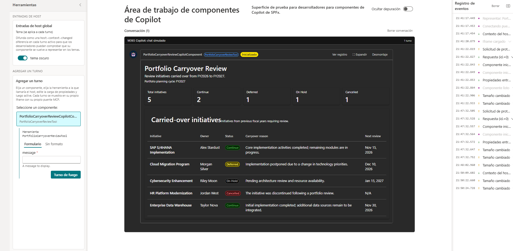

# Portfolio Carryover Review

## Summary

Portfolio Carryover Review is a Microsoft Copilot component that helps IT portfolio managers review initiatives carried over from one fiscal year to the next.

It provides a consolidated view of initiative status, ownership, carryover reasons, and planned review dates.

The sample is built with the SharePoint Framework (SPFx), React, and Fluent UI. It uses fictitious sample data and does not connect to external systems or services.

## Used SharePoint Framework Version

## Applies to

- [SharePoint Framework](https://learn.microsoft.com/sharepoint/dev/spfx/sharepoint-framework-overview)
- [Microsoft Copilot extensibility](https://learn.microsoft.com/microsoft-365-copilot/extensibility/)
- [Microsoft 365 tenant](https://learn.microsoft.com/sharepoint/dev/spfx/set-up-your-development-environment)

## Prerequisites

- Node.js compatible with SPFx 1.24.0.
- Access to a Microsoft 365 development tenant.
- SharePoint Framework development environment.

## Solution

| Solution | Author |
| -------- | ------ |
| portfolio-carryover-review | [Community contributor](https://github.com/a-villarruel) |

## Version history

| Version | Date | Comments |
| ------- | ---- | -------- |
| 1.0 | October 31, 2026 | Initial release |

## Minimal Path to Awesome

- Clone this repository or download this sample.
- Navigate to samples/portfolio-carryover-review.
- Install dependencies using npm install.
- Start the local development server using npm start.
- Open SharePoint Copilot Workbench in your Microsoft 365 tenant and load the local debug manifests.

To create a production build, run npm run build.

## Features

- Review initiatives carried over between fiscal years.
- View initiative status: Continue, Deferred, On Hold, and Cancelled.
- Identify initiative owners and carryover reasons.
- Review planned follow-up dates.
- Display portfolio summary indicators.
- Adapt the component appearance to light and dark themes.

The sample uses fictitious data for demonstration purposes. It does not implement data persistence, workflow management, or integration with external portfolio systems.

## Disclaimer

**THIS CODE IS PROVIDED AS IS WITHOUT WARRANTY OF ANY KIND, EITHER EXPRESS OR IMPLIED, INCLUDING ANY IMPLIED WARRANTIES OF FITNESS FOR A PARTICULAR PURPOSE, MERCHANTABILITY, OR NON-INFRINGEMENT.**

## References

- [Overview of SharePoint Copilot Apps](https://learn.microsoft.com/sharepoint/dev/spfx/copilot/overview-copilot-apps)
- [Build your first SharePoint Copilot App](https://learn.microsoft.com/sharepoint/dev/spfx/copilot/get-started/build-your-first-copilot-app)
- [SharePoint Framework documentation](https://learn.microsoft.com/sharepoint/dev/spfx/sharepoint-framework-overview)
- [Microsoft 365 Patterns and Practices](https://aka.ms/m365pnp)

