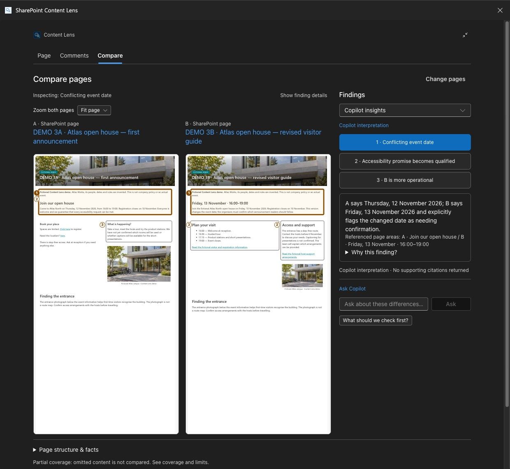
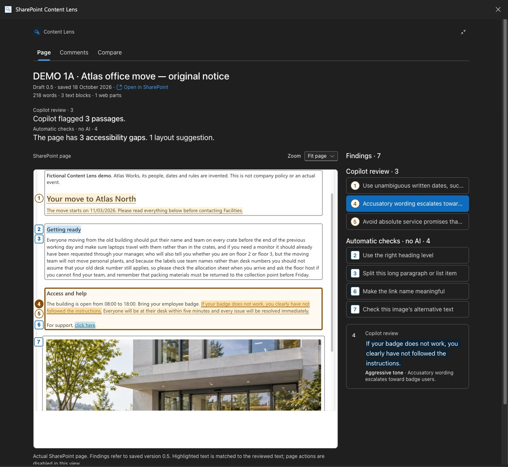
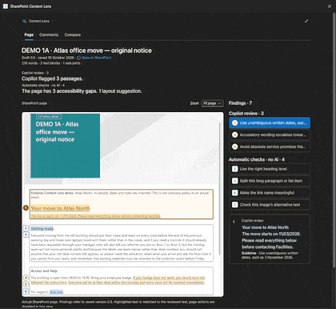
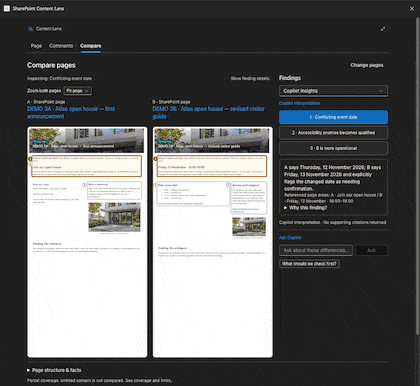
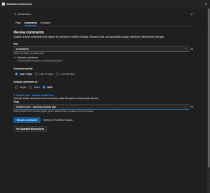
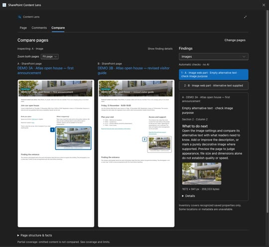
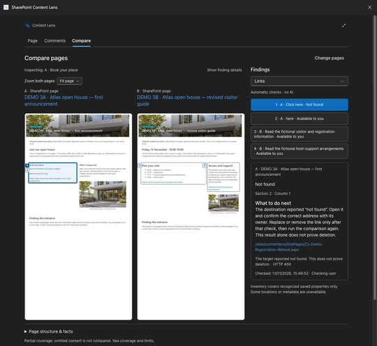
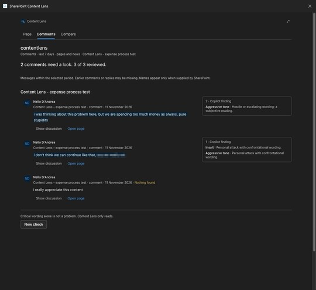

# Content Lens

## Summary

**Content Lens** is a sample publishing assistant for SharePoint, built as a [Copilot UX component](https://learn.microsoft.com/sharepoint/dev/spfx/copilot/overview-copilot-apps) with the SharePoint Framework (SPFx). Inside Microsoft 365 Copilot, a publisher can:

- **Compare two pages** or news posts side by side. Copilot names where they differ in terms, dates or promises. Measured checks cover accessibility, images and links.
- **Check a page**, published or a saved draft, for harmful wording and against writing guidelines that the publisher types in.
- **Review comments:** the wording of a site's comments over 7, 14 or 30 days.

**The sample shows how a Copilot UX component renders a live SharePoint page and marks areas on it:**

- Findings are marked where they occur on the actual page: amber for Copilot findings, blue for checks without AI.
- A marked finding has its number in the margin of the page, and the same number in the list.
- A light runs around the block of a selected finding.

The publisher sees the flagged places on the page. The list beside the page says why each finding was flagged, and a selected finding shows the details.

### Compare two pages

In the example above, two pages describe the same open house: a first announcement and a revised visitor guide. Copilot listed three insights. The selected one is the date: page A says 12 November, page B says 13 November. The component frames the places on both pages in amber and shows Copilot's explanation beside them.

### Check a page

In the example above, a page announces an office move. Copilot checked it against writing guidelines and for harmful wording. It flagged three passages, marked in amber: an ambiguous date, an accusatory sentence and an absolute promise. The checks without AI found four more issues, marked in blue: a skipped heading level, a long paragraph, a vague link name and an image without alternative text. The selected finding shows its wording and the reason.

### Further examples

<table>
  <tr>
    <td align="center" valign="top">
       
      <b>Page</b> Findings selected one after the other, each marked on the page and explained beside it
    </td>
    <td align="center" valign="top">
       
      <b>Compare</b> Copilot insights, then image and link checks, each marked where it occurs
    </td>
    <td align="center" valign="top">
       
      <b>Comments</b> A site and a period are chosen; two of three comments are flagged
    </td>
  </tr>
  <tr>
    <td align="center" valign="top">
       
      <b>Image checks</b> An image without alternative text on page A, with its dimensions and file size
    </td>
    <td align="center" valign="top">
       
      <b>Link checks</b> Each link with its state; a destination on page A was not found
    </td>
    <td align="center" valign="top">
       
      <b>Comments result</b> Three comments; Copilot's finding beside the two flagged ones
    </td>
  </tr>
</table>

Select a thumbnail for the full capture. The pages shown are fictional.

### Technique: a live SharePoint page with marks

- In Microsoft 365 Copilot, the component runs on the tenant's SharePoint domain, the same domain as the tenant's pages. It can therefore load a page in an iframe and read the rendered page.
- The component finds the saved text blocks and web parts in the rendered page and draws an overlay over them. The saved page is not changed.
- Possible use: show any result that refers to a part of a page at its place, such as review notes or the results of other checks.

### How it works

- Content Lens reads SharePoint with the user's own access and changes nothing there.
- It asks Copilot through the [Microsoft 365 Copilot Chat API](https://learn.microsoft.com/en-us/microsoft-365/copilot/extensibility/api/ai-services/chat/overview).
- Twelve checks for accessibility, layout and freshness run without AI.

More detail: [architecture](./docs/ARCHITECTURE.md) and [demo scenarios](./docs/DEMO_SCENARIOS.md).

## Compatibility

> This sample targets SPFx 1.24.1. The Microsoft 365 Copilot Chat API is in preview, on the Microsoft Graph `/beta` endpoint.

## Applies to

- [SharePoint Framework](https://learn.microsoft.com/sharepoint/dev/spfx/sharepoint-framework-overview) 1.24 and later: [Copilot UX components](https://learn.microsoft.com/sharepoint/dev/spfx/copilot/overview-copilot-apps)
- [Microsoft Copilot extensibility](https://learn.microsoft.com/microsoft-365-copilot/extensibility/)
- [Microsoft 365 tenant](https://learn.microsoft.com/sharepoint/dev/spfx/set-up-your-developer-tenant) with a SharePoint App Catalog and Microsoft 365 Copilot

## Contributors

- [Nello D'Andrea](https://github.com/ferrarirosso)

## Version history

| Version | Date | Comments |
| --- | --- | --- |
| 0.14.21 | November 15, 2026 | Initial release |

## Prerequisites

- Node.js **>=22.14.0 and <23.0.0**; see [Set up your SharePoint Framework development environment](https://learn.microsoft.com/sharepoint/dev/spfx/set-up-your-development-environment)
- A SharePoint App Catalog and permission to deploy to it
- The [Microsoft 365 Copilot add-on license](https://learn.microsoft.com/sharepoint/dev/spfx/copilot/overview-copilot-apps#licensing-and-costs) for each user
- Approval of the API permissions of the Chat API on the [API access page](https://learn.microsoft.com/sharepoint/api-access) of the SharePoint admin center. Approval for Microsoft Graph requires a Global Administrator.

### Why the package requests seven Graph permissions

The [Microsoft 365 Copilot Chat API](https://learn.microsoft.com/en-us/microsoft-365/copilot/extensibility/api/ai-services/chat/overview) accepts a call only when all seven of its delegated permissions are granted. This is [Microsoft's rule](https://learn.microsoft.com/en-us/microsoft-365/copilot/extensibility/api/ai-services/chat/copilotroot-post-conversations#permissions) for every caller of the API:

`Sites.Read.All`, `Mail.Read`, `People.Read.All`, `OnlineMeetingTranscript.Read.All`, `Chat.Read`, `ChannelMessage.Read.All`, `ExternalItem.Read.All`

- Content Lens itself reads no mail, chats or meeting transcripts. Its only Graph calls are the Chat API calls.
- SharePoint [grants approved permissions to all SPFx components in the tenant](https://learn.microsoft.com/sharepoint/dev/spfx/use-aadhttpclient#granted-permissions-apply-to-the-entire-tenant), so use a development tenant.
- Without the approval, the checks without AI still run.

## Minimal path to awesome

- Clone this repository, or [download this sample as a .ZIP file](https://pnp.github.io/download-partial/?url=https://github.com/pnp/spfx-copilot-components/tree/main/samples/sharepoint-content-lens) and unzip it
- From your command line, change to the sample folder, `samples/sharepoint-content-lens`
- In the command line run:
  - `npm install`
  - `npm run build`

`npm run build` runs the tests, packages the solution and checks the package.

To deploy:

1. Upload `sharepoint/solution/sharepoint-content-lens.sppkg` to the tenant's SharePoint App Catalog and enable it. Approve the API permissions.
2. Select **Add to Teams** for the solution. This action performs **Sync to Teams** and deploys the declarative agent. Repeat it after a change to the baseline agent, such as its instructions or starter prompts.
3. Make the agent **SharePoint Content Lens** available to its users on the [Agents page](https://admin.cloud.microsoft/#/agents/all) of the Microsoft 365 admin center, or install it from the [Agent Store](https://m365.cloud.microsoft/chat/agentstore).
4. In a new conversation with the agent, ask: *Open Content Lens so I can check a page against my writing rules.*

These are the steps of [Deploy the baseline agent once](https://learn.microsoft.com/sharepoint/dev/spfx/copilot/development-and-deployment#deploy-the-baseline-agent-once) in Microsoft's documentation.

To run the component from your machine, use `npm run start` with the Copilot Workbench: see [Test with the Copilot Workbench](https://learn.microsoft.com/sharepoint/dev/spfx/copilot/overview-copilot-apps#test-with-the-copilot-workbench).

## Features

This sample illustrates the following concepts. The paths are relative to the component's folder in this sample, `src/copilotComponents/contentLens/`.

- **A live SharePoint page in the component, with marks drawn over it:** `components/PagePreview.tsx` loads the page in a same-origin iframe. `components/livePageDom.ts` matches the saved web parts to the rendered ones and draws the overlay.
- **A call to the Microsoft 365 Copilot Chat API from the component, with a checked answer:** `services/copilotReview.ts` sends each request to the Chat API. `roundTrip/` packs the text into numbered passages and accepts only findings that cite them. The folder has its own README and imports nothing from SharePoint or the views.
- **Two pages side by side**, with Copilot insights and follow-up questions: `comparison/`.
- **Twelve checks without AI** for headings, link names, alternative text, tables, layout and dates: the catalog is `domain/checkCatalog.ts`; `services/sharePointParsing.ts` and `domain/freshness.ts` find the issues.
- **Paced SharePoint reads** that pause on 429 and 503 responses: `services/sharePointContentService.ts`.
- English and German, light and dark themes, inline and fullscreen, and a built-in fictional example.

## Help

We do not support samples, but this community is always willing to help, and we want to improve these samples. We use GitHub to track issues, which makes it easy for community members to volunteer their time and help resolve issues.

You can try looking at [issues related to this sample](https://github.com/pnp/spfx-copilot-components/issues) to see if anybody else is having the same issues.

If you encounter any issues using this sample, [create a new issue](https://github.com/pnp/spfx-copilot-components/issues/new).

## References

- [Overview of Copilot UX components](https://learn.microsoft.com/sharepoint/dev/spfx/copilot/overview-copilot-apps)
- [Develop and deploy Copilot UX components](https://learn.microsoft.com/sharepoint/dev/spfx/copilot/development-and-deployment)
- [Build your first Copilot UX component](https://learn.microsoft.com/sharepoint/dev/spfx/copilot/get-started/build-your-first-copilot-app)
- [Manage access to Microsoft Entra ID-secured APIs](https://learn.microsoft.com/sharepoint/api-access)
- [Microsoft 365 Copilot Chat API overview](https://learn.microsoft.com/en-us/microsoft-365/copilot/extensibility/api/ai-services/chat/overview)
- [SharePoint Framework 1.24 release notes](https://learn.microsoft.com/sharepoint/dev/spfx/release-1.24.0)

## Disclaimer

**THIS CODE IS PROVIDED _AS IS_ WITHOUT WARRANTY OF ANY KIND, EITHER EXPRESS OR IMPLIED, INCLUDING ANY IMPLIED WARRANTIES OF FITNESS FOR A PARTICULAR PURPOSE, MERCHANTABILITY, OR NON-INFRINGEMENT.**

