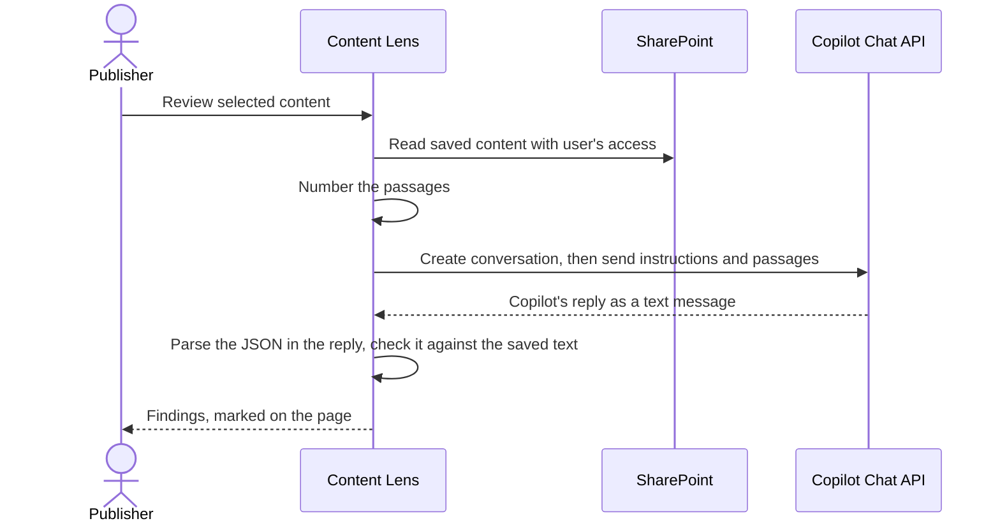

# Content Lens architecture

How the code is organized and how a review travels to Copilot and back. The [README](../README.md) covers setup and use.

## Review flow

The agent has one tool, `OpenSharePointContentLens`, which opens the component. The component calls the Chat API itself, and the results appear only in the component. Copilot's reply in the conversation says that Content Lens is open.

- **Read.** Content Lens reads SharePoint with the signed-in user's own access and changes nothing there.
- **Number.** The text is cut at sentence ends into short numbered passages.
- **Send.** Each request goes to a new conversation of the Microsoft 365 Copilot Chat API, through the SPFx Graph client. It holds the review instructions and the numbered passages; the instructions ask Copilot to reply with one JSON object. A long page takes several requests. The names of comment authors are not sent.
- **Check.** The Chat API returns Copilot's reply as text, and the component parses the JSON in it. The reply cites passage numbers, and the component accepts a finding only when the cited passage is part of the saved text. Text produced by the model is never used as evidence. The [README of `roundTrip/`](../src/copilotComponents/contentLens/roundTrip/README.md) describes the reply format and its checks.

## Code map

All source is under `src/copilotComponents/contentLens/`.

| Area | Files | Responsibility |
| --- | --- | --- |
| Host integration | `ContentLensCopilotComponent.tsx`, `ContentLensCopilotComponentProperties.ts` | Mounts the views, handles the display mode, supplies the Graph and SharePoint clients, defines the input schema of the tool |
| Exchange with Copilot | `roundTrip/` | Passages, request packing, the answer schema and its validation; `componentSurface.ts` keeps one React root per DOM node. Imports nothing from SharePoint or the views; see its [README](../src/copilotComponents/contentLens/roundTrip/README.md). |
| Chat API | `services/copilotReview.ts`, `comparison/chat.ts` | The calls for Page and Comments with the review instructions; the Compare conversation |
| Review state | `services/reviewSession.ts`, `reviewCache.ts`, `analysis.ts` | The review across several requests. A component that the host opens again shows the kept review. |
| Reading SharePoint | `services/sharePointContentService.ts`, `sharePointParsing.ts`, `discovery.ts` | Page text and structure, comments, site and page lookup |
| Checks without AI | `domain/checkCatalog.ts`, `domain/freshness.ts`, `components/checkRules.ts` | The 12 checks as one catalog, with thresholds and rule texts |
| Views | `components/` | `ContentLens.tsx` holds state and workflows; `PagePreview.tsx` and `livePageDom.ts` show the live page and its marks |
| Compare | `comparison/` | Two pages side by side: evidence, image and link checks, the workspace view |
| Example | `services/fixtures.ts`, `comparison/demo.ts` | The fictional example with prepared findings |

## The live page and its marks

- **Load.** `PagePreview.tsx` shows the page in an iframe and checks that the page version is the reviewed one.
- **Match.** `livePageDom.ts` finds each saved web part in the rendered page by its ID. A text block must also have the same text.
- **Draw.** An overlay frames each block that has a finding, marks the flagged wording and puts the number of the finding in the margin: amber for Copilot, blue for checks without AI (`markStyle.ts`). The saved page is not changed.

## Compare

- `ComparisonView.tsx` reads page A, then page B, through `services.ts`, and shows both pages with their marks. `evidence.ts` builds facts and rule findings from the saved structure.
- `chat.ts` keeps its own Chat API conversation for insights and follow-up questions. An answer cites evidence IDs such as `A:block:<id>`, which are validated and resolved back to the saved block. Model output never changes measured values.
