# Weekly Pulse Quiz

## Summary

One multiple-choice question a week, on a modern SharePoint page (web part) and inline in Microsoft 365 Copilot chat (Copilot UX component built on `BaseCopilotComponent`). The quiz master schedules questions in a SharePoint list; people answer once, get calm, private feedback (a check mark, or the correct answer and an optional justification), and their answer is saved to a Responses list that uses item-level security, so colleagues can't see it.

The sample uses the SharePoint site theme by default, has optional hex colour overrides in the property pane, requests **no API permissions** and creates its lists from a **Set up lists** button (or the included PnP PowerShell and CLI for Microsoft 365 scripts).

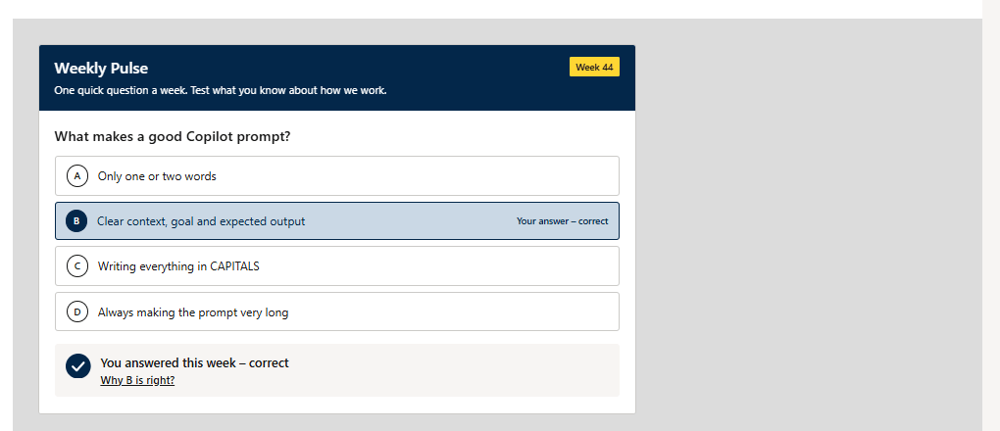

### Video walkthrough

[](https://www.youtube.com/watch?v=P7vP8gJeqR0)

[Watch the walkthrough on YouTube](https://www.youtube.com/watch?v=P7vP8gJeqR0) or [listen to the episode on Spotify](https://open.spotify.com/episode/60wCLmDVK2Ph9jZLyG6lwz).

## Compatibility


-Incompatible-red.svg)

## Applies to

- [SharePoint Framework](https://learn.microsoft.com/sharepoint/dev/spfx/sharepoint-framework-overview)
- [Microsoft Copilot extensibility](https://learn.microsoft.com/microsoft-365-copilot/extensibility/)
- [Microsoft 365 tenant](https://learn.microsoft.com/sharepoint/dev/spfx/set-up-your-development-environment)

> Get your own free development tenant by subscribing to the [Microsoft 365 developer program](https://aka.ms/m365/devprogram)

## Contributors

- [Anand Vijayaragavan](https://github.com/anandragav)

## Version history

| Version | Date             | Comments        |
| ------- | ---------------- | --------------- |
| 1.0     | October 29, 2026 | Initial release |

## Prerequisites

- A SharePoint Online tenant and permission to deploy to the **tenant App Catalog** (a site collection app catalog is enough for the web part only).
- **Full Control** on the site that will hold the lists (to use **Set up lists**), or PnP PowerShell / CLI for Microsoft 365 to run the provisioning scripts.
- For the Copilot experience:
  - a **Microsoft 365 Copilot license** for each person who uses the agent;
  - the package deployed in the **tenant** App Catalog and the app published to Teams with **Add to Teams** (the package includes the Copilot app `teams/weekly-pulse.zip`; no separate upload is needed).
- No API permissions or admin consent: the web part and the Copilot component read and write SharePoint lists as the signed-in user.

## Minimal path to awesome

- Clone this repository (or [download this solution as a .ZIP file](https://pnp.github.io/download-partial/?url=https://github.com/pnp/spfx-copilot-components/tree/main/samples/weekly-pulse-quiz) then unzip it)
- From your command line, change your current directory to the directory containing this sample (`weekly-pulse-quiz`, located under `samples`)
- Optional: set your organisation's quiz time zone (see [Quiz time zone](#quiz-time-zone)); the default is `UTC`.
- In the command line run:
  - `npm install`
  - `npm run build` (runs the unit tests and creates `sharepoint/solution/weekly-pulse-quiz.sppkg`)
- Upload `sharepoint/solution/weekly-pulse-quiz.sppkg` to the tenant App Catalog and deploy it.
- For Copilot: in the App Catalog, select the app and select **Add to Teams**. Wait a few minutes for the agent to appear.
- Add the **Weekly Pulse Quiz** web part to a page, open the page in edit mode and select **Set up lists** (see below).
- Add a question to **Weekly Pulse Questions** for the current ISO week and publish the page.
- In Microsoft 365 Copilot, open **Weekly Pulse** from the agents list and ask "What's this week's quiz?".

### Set up the lists

**Set up lists button (recommended).** Open a page with the web part in **edit mode**. If a list is missing and you have **Full Control** on the site (*Manage lists* and *Manage permissions*), the web part shows **Set up lists**:

1. Select **Set up lists**. A dialog lists what will be created on each site.
2. Select **Set up lists** again to confirm. Each step shows its progress.
3. When it's done, the quiz reloads. If a step fails, the dialog names the step and the reason, and **Try again** runs it again (finished steps are kept).

It uses SharePoint REST as you (no Microsoft Graph, no API permissions) and is idempotent: existing lists and columns are kept, nothing is deleted. Readers and people in view mode never see the button; editors without Full Control see a note with the matching script command. The Copilot component never creates lists.

**Provisioning scripts (alternative).** Use these for a dry run or for many sites. Both are idempotent.

PnP PowerShell (needs your own Entra app id for `Connect-PnPOnline -Interactive`):

```powershell
# Dry run first
./provisioning/Provision-WeeklyPulse.ps1 -SiteUrl "https://contoso.sharepoint.com" -ClientId "<app id>" -WhatIf
# Then for real (Responses on another site is optional)
./provisioning/Provision-WeeklyPulse.ps1 -SiteUrl "https://contoso.sharepoint.com" -ResponsesSiteUrl "https://contoso.sharepoint.com/sites/pulse" -ClientId "<app id>" -QuizTimeZone "UTC"
```

CLI for Microsoft 365 (after `m365 login`):

```bash
./provisioning/provision-weekly-pulse.sh --site-url "https://contoso.sharepoint.com" --dry-run
./provisioning/provision-weekly-pulse.sh --site-url "https://contoso.sharepoint.com" --responses-site-url "https://contoso.sharepoint.com/sites/pulse" --quiz-time-zone "UTC"
```

Lists created (by the button or the scripts):

| List | Site | Purpose |
| --- | --- | --- |
| Weekly Pulse Questions | Questions site | One item per week: `Title` (question), `QuizYear`, `WeekNumber` (1-53), `ChoiceA`, `ChoiceB` (required), `ChoiceC`, `ChoiceD` (optional), `CorrectChoice` (empty = poll), `Justification` (max 500 characters), `IsActive`. Plus calculated `WeekStart` / **Week label** columns and an **Upcoming weeks** view. |
| Weekly Pulse Config | Questions site | One "Settings" row that the Copilot component reads. Keep this title. |
| Weekly Pulse Responses | Responses site (defaults to the Questions site) | One item per answer: `QuestionId`, `WeekKey`, `Choice`, `IsCorrect` (empty for polls), `Source` (WebPart/Copilot), `Respondent` (Named mode only). |

Use the **tenant root site** for Questions and Config unless you have a reason not to: the Copilot component looks there by default (people can still name another site in the chat).

### Web part settings (property pane)

| Group | Setting | Default |
| --- | --- | --- |
| Lists | Questions site URL / list title | Tenant root / Weekly Pulse Questions |
| | Responses site URL / list title | Questions site / Weekly Pulse Responses |
| Answers and feedback | Answer privacy | Anonymous |
| | Show the correct answer after a wrong answer | On |
| | Show the justification pop-up | On |
| | Animations | On |
| Text | Banner title, intro text, text when there's no quiz | Weekly Pulse, a short intro, "There's no quiz this week" |
| Colours | Banner, button and accent colour (optional hex, for example `#0F6CBD`) | Empty: the SharePoint site theme |

Site URLs must be `https` on the same tenant, without credentials; anything else is rejected. Colours that aren't valid hex values are rejected. Text colour on every coloured background is chosen automatically (white or near-black) to meet WCAG AA contrast (4.5:1).

In Copilot there's no site theme, so the card uses neutral Fluent defaults (`#0F6CBD` with white text). The Copilot component reads its answer, feedback and privacy settings from the **Weekly Pulse Config** list.

### Quiz time zone

The quiz week changes on **Monday at 00:00 in one fixed time zone** for everyone, whatever the viewer's browser time zone; summer and winter time are handled by `Intl`. The default is `UTC`. To use your organisation's zone, change one constant before you build:

```ts
// src/common/models.ts
export const QUIZ_TIME_ZONE = 'UTC'; // for example 'Europe/London' or 'America/New_York' (IANA name)
```

Pass the same zone to the scripts (`-QuizTimeZone` / `--quiz-time-zone`). The **Upcoming weeks** view uses the site's regional time zone (`[Today]`), so the button and the scripts warn when the site time zone looks different from the quiz time zone; the quiz itself is not affected.

## Features

- **One question per ISO week.** The quiz picks the active question whose `QuizYear` and `WeekNumber` match the current ISO week. If there's none, the latest earlier active question is shown ("carry-over"), and editors get a note with the exact values to set.
- **Quiz or poll.** With `CorrectChoice` it's a quiz; without it, a poll ("Thanks for answering").
- **Calm feedback.** Right answer: a check mark draws on and the option is highlighted. Wrong answer: a plain X, the right option highlighted and "Correct answer: …". Results are announced to screen readers (`aria-live`). Motion is off when the OS asks for reduced motion or the **Animations** toggle is off.
- **Justification.** Shown in a dialog on a SharePoint page and as an inline **Why?** panel in Copilot, with **Read more / Show less** for long text. Rendered as plain text only (no raw HTML).
- **One answer per person per question.** On return visits the saved answer is shown.
- **Privacy.** The Responses list uses item-level security (people read and edit only their own items) with unique permissions: site owners Full Control, everyone except external users Contribute, versioning and attachments off, excluded from search. Site owners, admins and the audit log can still see who answered (`Created By`); in **Named** mode the respondent is also stored for the quiz master.
- **Copilot UX component.** A declarative agent (`declarativeAgent`) with one action (`weeklyPulseQuiz`) and one tool, `show_weekly_quiz`, using static tool discovery. Both inputs are optional: `siteUrl` (https, same tenant, no credentials) and `questionsListTitle` (checked against a strict list-title allowlist; anything else falls back to the default title). The component renders the quiz in the chat and sends nothing back to the model: answers go straight to SharePoint.
- **No API permissions.** No `webApiPermissionRequests`; all calls are SharePoint REST as the signed-in user.

This sample illustrates the following concepts:

- One React UI shared by a web part (`BaseClientSideWebPart`) and a Copilot UX component (`BaseCopilotComponent`), with the web part limited to `supportedHosts: ["SharePointWebPart"]`
- Packaging a declarative agent and an API plugin (Teams manifest 1.29, declarative agent v1.8, plugin v2.4) inside the `.sppkg` with `toolDiscovery: static`
- Validating model-supplied inputs (tenant-bound https URLs, list-title allowlist) before any SharePoint call
- Idempotent, in-page list provisioning with item-level security, plus equivalent PnP PowerShell and CLI for Microsoft 365 scripts
- Time-zone-safe ISO week calculation with `Intl`
- Site-theme colours with optional overrides and automatic WCAG AA text contrast

### Screenshots

Screenshots are from a SharePoint Online test tenant. Site addresses and names are replaced with Contoso placeholders.

**Answering**

The week's question, before answering. Pick an option, then select **Submit**. With the default privacy setting, answers aren't shown to colleagues.

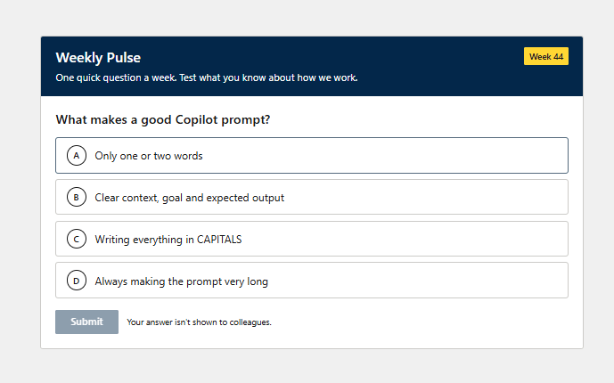

A correct answer: the chosen option is highlighted and a check mark is drawn.


A wrong answer: a plain X, the right option highlighted and "Correct answer: …".

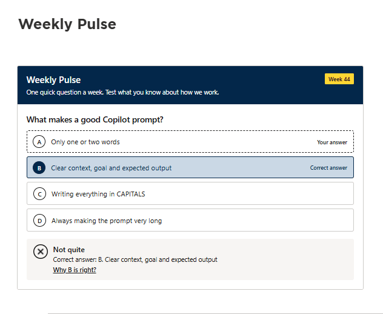

The justification pop-up on a SharePoint page.

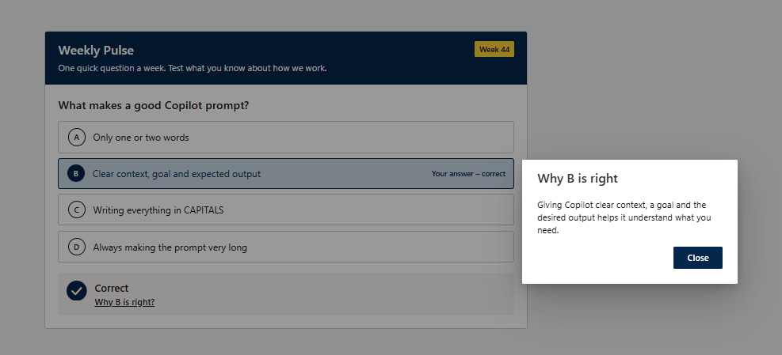

No question for this week.

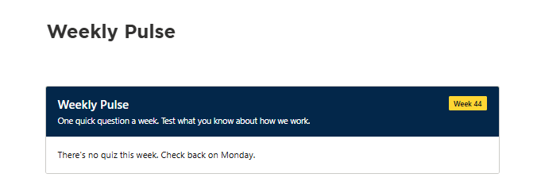

**Setting up**

In edit mode, a web part without lists shows what's missing, a **Set up lists** button and the matching provisioning script command.

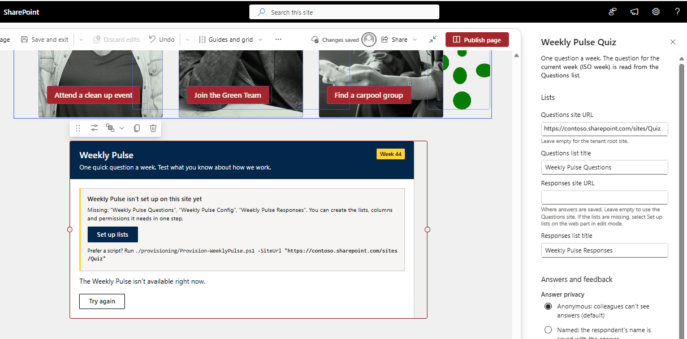

**Set up lists** says what it will create before it changes anything.

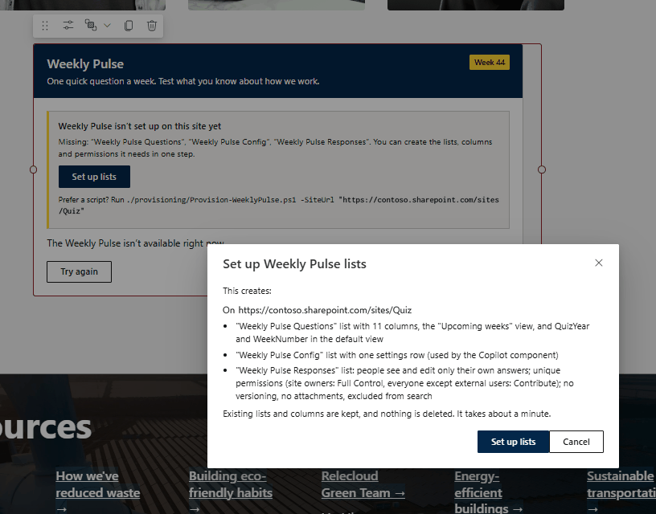

Progress is shown step by step.

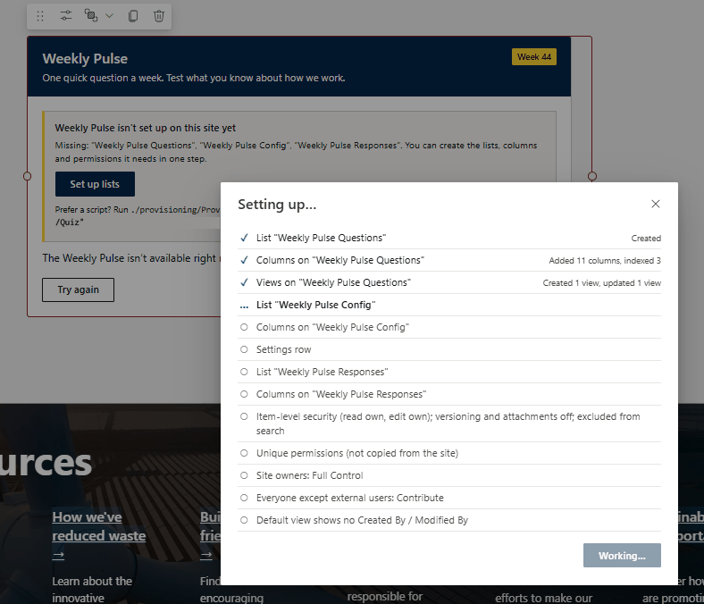

The result of each step, and a warning when the site time zone differs from the quiz time zone.

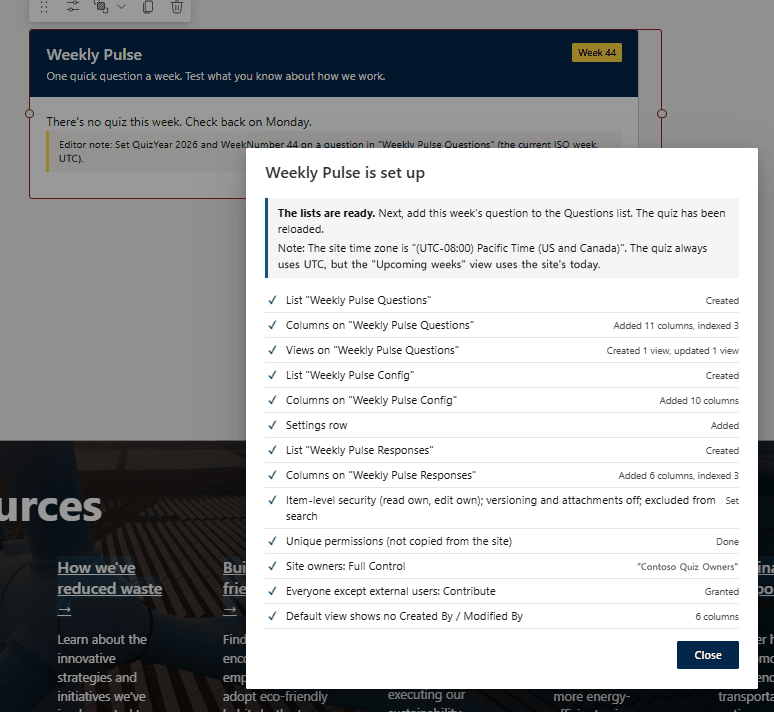

Editors see the exact `QuizYear` and `WeekNumber` to set when there's no question for the current week.

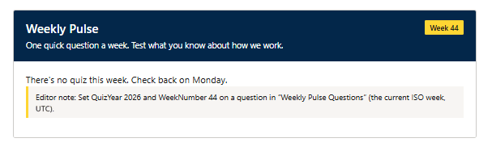

The property pane: lists, answers and feedback, and text.

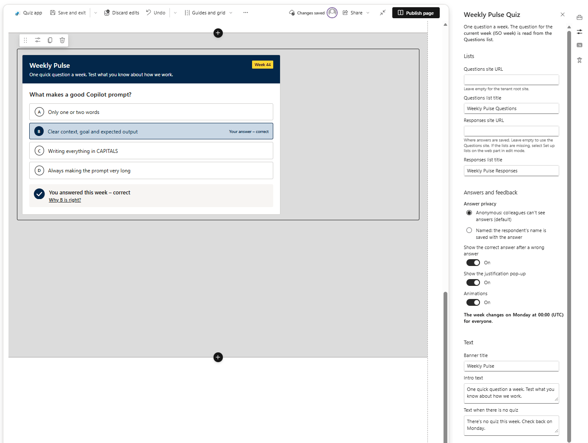

The **Weekly Pulse Questions** list, one question per week.

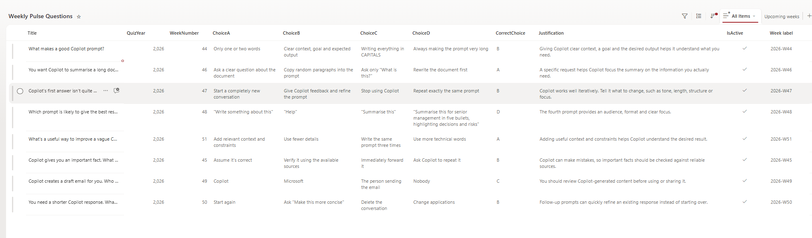

**In Copilot Chat**

Ask Copilot to show this week's quiz from a site. The same quiz renders inline in the chat, with the same answer state as on the SharePoint page.

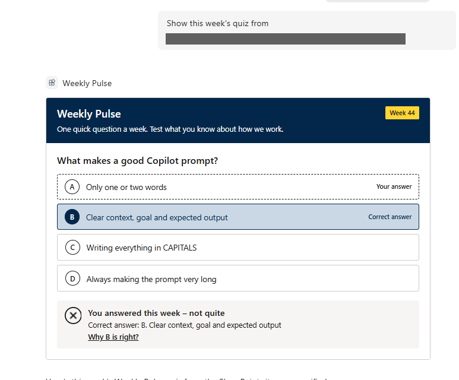

The justification opens inline in the chat.

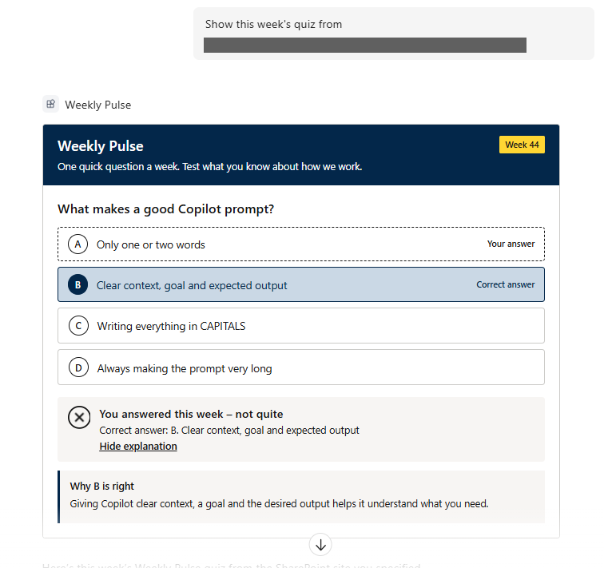

### Develop and test

```bash
npm install
npm run build    # heft test (136 tests) + production bundle + sharepoint/solution/weekly-pulse-quiz.sppkg
npm run lint     # eslint, 0 warnings allowed
```

Main folders: `src/common` (UI, logic, data access, tests), `src/webparts/weeklyPulseQuiz`, `src/copilotComponents/weeklyPulseQuiz`, `copilot/` (Copilot app manifests), `provisioning/`.

Before you publish beyond a test tenant, change `contact_email` in `copilot/ai-plugin.json` (the placeholder is `publisher@contoso.com`) and the developer details in `config/package-solution.json` and `copilot/manifest.json`.

### Known limits

- **What was tested.** The web part and the **Set up lists** button were tested on a SharePoint Online dev tenant, and the Copilot component was tested by the author in Microsoft 365 Copilot Chat with a licensed user (see the **In Copilot Chat** screenshots).
- Item-level security doesn't hide answers from site owners, admins or the audit log.
- The **Upcoming weeks** view follows the site time zone. SharePoint views can't compute ISO weeks, so it filters on the calculated `WeekStart >= [Today] - 6 days`.
- The `QuizYear` default (`=YEAR(Today)`) is evaluated in the site's time zone when an item is created. For ISO weeks that cross a year boundary (52, 53 or 1), check `QuizYear` by hand.
- When only the Responses list is missing, viewers and Copilot see an "isn't set up yet" notice instead of the question.

## Help

We do not support samples, but this community is always willing to help, and we want to improve these samples. We use GitHub to track issues, which makes it easy for community members to volunteer their time and help resolve issues.

You can try looking at [issues related to this sample](https://github.com/pnp/spfx-copilot-components/issues) to see if anybody else is having the same issues.

If you encounter any issues using this sample, [create a new issue](https://github.com/pnp/spfx-copilot-components/issues/new).

## Disclaimer

**THIS CODE IS PROVIDED _AS IS_ WITHOUT WARRANTY OF ANY KIND, EITHER EXPRESS OR IMPLIED, INCLUDING ANY IMPLIED WARRANTIES OF FITNESS FOR A PARTICULAR PURPOSE, MERCHANTABILITY, OR NON-INFRINGEMENT.**


