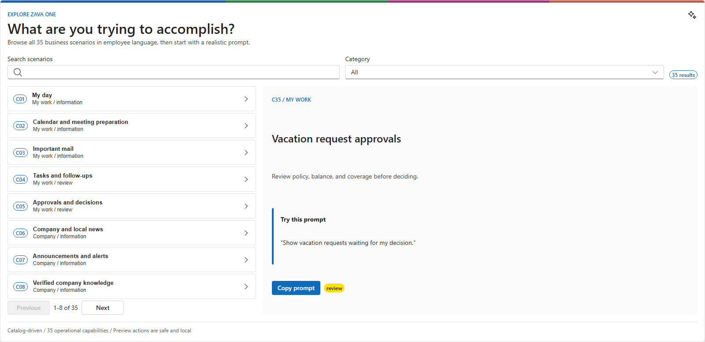
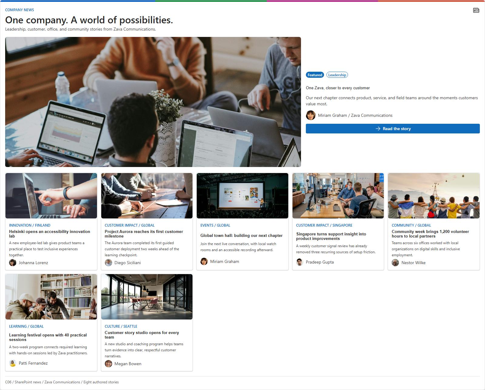
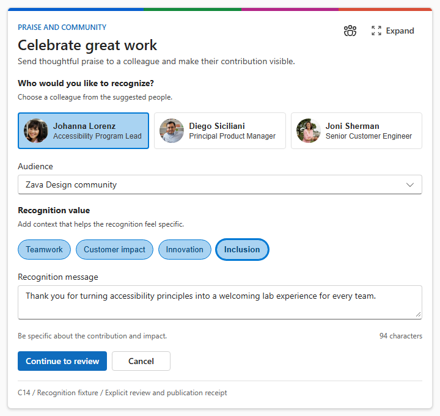
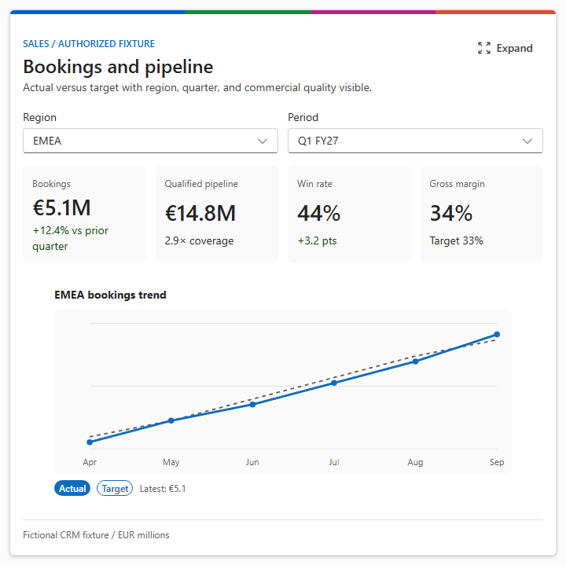
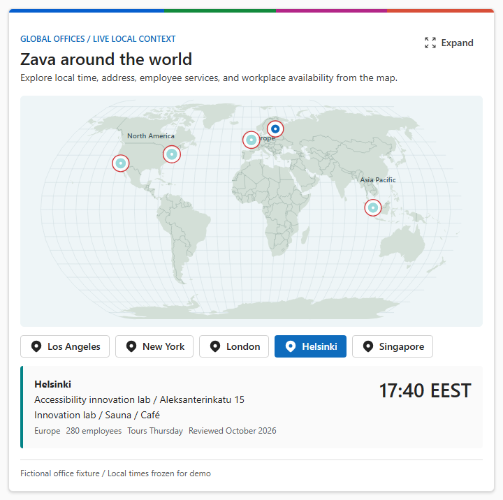
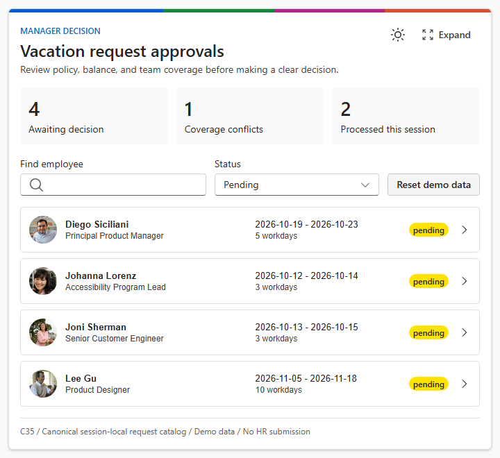
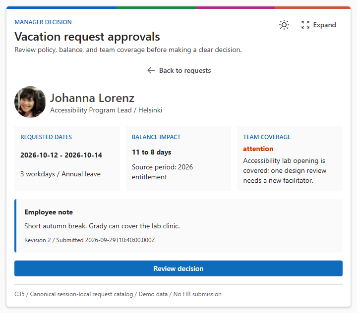
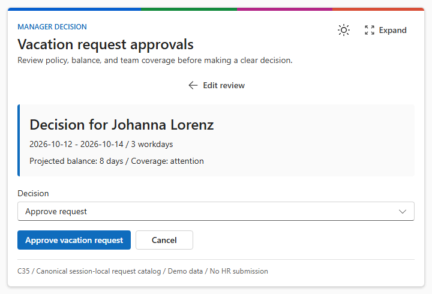
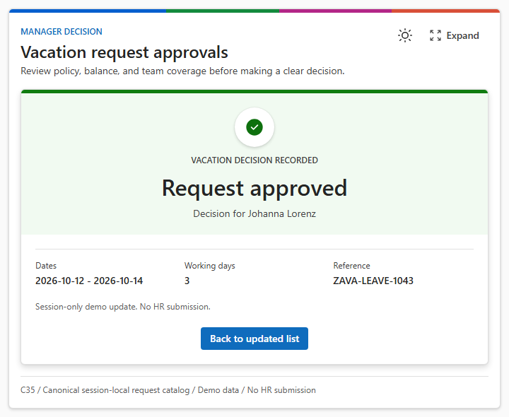
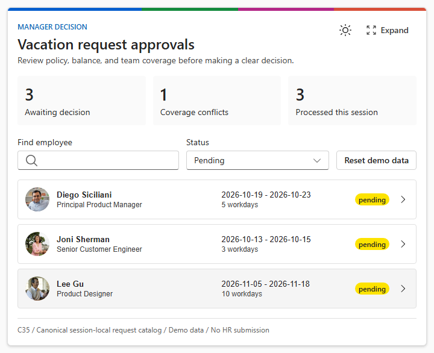

# Zava One

> **SPFx 1.24.0 GA upgrade (October 28, 2026):** Build dependencies target GA.
> React/ReactDOM use 18.3.1. Earlier readiness reports, screenshots, test counts,
> and tenant evidence remain historical, not fresh GA host certification.
> Restore was validated using the configured Microsoft npm proxy; npmjs.org did not yet expose
> all required GA packages. Use an approved registry with 1.24.0 available; do not commit credentials.


## Applies To

- SharePoint Framework `1.24.0` Copilot Components
- Microsoft Copilot declarative agents
- SharePoint Online and Microsoft Teams
- React `18.3.1`, Fluent UI React v9, and Node.js 22

**Your company, wherever you work.**

Zava One is a fixture-first employee experience built with SharePoint Framework Copilot Components,
React 18, Fluent UI v9, Griffel, and focused D3 modules. It combines a Company-first communications
experience with Personal work and services while preserving focused, intent-sized Copilot answers.

The same shared React capability powers:

- an independently configurable SharePoint web part;
- an intent-specific Copilot inline experience;
- the owning Company or Personal workspace inside Copilot full screen; and
- one of three composed SharePoint/Teams workspace experiences.



> **Historical RC0 status:** the demo had a passing local test suite,
> 4,080 responsive browser states, 39 captured engineering
> screenshots, 15 reviewed publication images, and a committed production SPPKG. The sample author
> confirmed all three Teams personal apps work and supplied authenticated screenshots.
> Modern SharePoint host checks and complete host accessibility validation remain open.
> This historical evidence does not certify the upgraded package in a GA tenant.

This release uses React/ReactDOM **18.3.1**, React types **18.3.31 / 18.3.7**, and SPFx **1.24.0**.
Use Node.js 22 (22.14 or later), 24, or 26. Current local build and package checks remain
separate from historical authenticated screenshots.
The six starters have explicit [component targets](config/conversation-starters.json); policy lookup,
news, praise, sales, office discovery, and capability exploration remain independent tools.

**Present this sample:** [five-minute keynote](./demos/keynote-5-minutes.md) |
[technical demo](./demos/technical-demo-10-minutes.md) |
[business walkthrough](./demos/business-journey.md) |
[exact intent-to-component mapping](./docs/intent-component-mapping.md).
The mapping covers all 35 business intents, both infrastructure tools, six starters, optional
schemas, and current input/expansion limits. [Finalization progress](./todo.md) distinguishes
completed documentation from runtime and authenticated-host gates.

**Use in Cowork:** [zava-one-hub-plugin](./zava-one-hub-plugin/README.md) is the manually created plug-in
version of the agent, with its own agent identity and an app-level MCP connector. Package and deploy
it to your tenant as a plug-in for use in Cowork. It connects to the separately deployed SPFx
solution; it does not replace the SPPKG or the original generated agent. Follow the
[plug-in packaging and deployment guide](./zava-one-hub-plugin/README.md).

## Highlights

- **35 business capabilities**, each with one final-named SharePoint-only web part and one final-named
  Copilot Component generated through the SPFx Yeoman generator.
- **Three composed workspace web parts:** Zava One, Zava One Company, and Zava One Personal. Only these
  web parts advertise Teams host support; the distributed Teams app packages are personal-only.
- **One shared `ZavaOneWorkspace`** for SharePoint, Teams, and Copilot full screen. Company-only and
  Personal-only modes omit the top-level tab switcher.
- **C35 vacation approvals:** ranked queue, employee portraits, policy/balance/coverage evidence,
  decision review, explicit approval/decline, simulated receipt, updated queue, and deterministic reset.
- **Company newsroom:** eight substantial fictional Zava stories with named authors, bundled portraits,
  distinctive editorial photography, publication metadata, and six selectable layouts.
- **Decision-grade visualization:** focused D3 bar charts with exact-value tables and an offline Natural
  Earth office projection with equivalent marker/list selection.
- **Offline keynote reliability:** 28 provenance-checked media assets embedded once in the shared bundle;
  no runtime content or profile-photo request is required.
- **Copilot bridge behavior:** host-authoritative expansion, complete model-context snapshots, explicit
  user-triggered follow-ups, persistent React roots, and owner-document Fluent/Griffel rendering.

## Experience Gallery

Every capability has a settled local screenshot under
[`ux-review/evidence/all-experiences`](./ux-review/evidence/all-experiences). The generated inventory and
hashes are in
[`all-experiences-matrix.json`](./ux-review/evidence/all-experiences-matrix.json).

| ID | Experience | SharePoint web part | Copilot tool | Screenshot |
| --- | --- | --- | --- | --- |
| C01 | My day | MyDay | ShowMyDay | [View](./ux-review/evidence/all-experiences/c01-my-day.png) |
| C02 | Calendar and meeting preparation | Agenda | ShowMyAgenda | [View](./ux-review/evidence/all-experiences/c02-agenda.png) |
| C03 | Important mail | ImportantMail | ShowImportantMail | [View](./ux-review/evidence/all-experiences/c03-important-mail.png) |
| C04 | Tasks and follow-ups | Tasks | ShowMyTasks | [View](./ux-review/evidence/all-experiences/c04-tasks.png) |
| C05 | Approvals and decisions | Approvals | ShowMyApprovals | [View](./ux-review/evidence/all-experiences/c05-approvals.png) |
| C06 | Company and local news | CompanyNews | ShowCompanyNews | [View](./ux-review/evidence/all-experiences/c06-company-news.png) |
| C07 | Announcements and alerts | ActiveAnnouncements | ShowActiveAnnouncements | [View](./ux-review/evidence/all-experiences/c07-announcements.png) |
| C08 | Verified company knowledge | CompanyKnowledge | FindCompanyKnowledge | [View](./ux-review/evidence/all-experiences/c08-knowledge.png) |
| C09 | Apps and employee services | EmployeeServices | FindEmployeeService | [View](./ux-review/evidence/all-experiences/c09-employee-services.png) |
| C10 | Company events and town halls | CompanyEvents | ShowCompanyEvents | [View](./ux-review/evidence/all-experiences/c10-company-events.png) |
| C11 | People and expertise | People | FindPeople | [View](./ux-review/evidence/all-experiences/c11-people.png) |
| C12 | Onboarding and transitions | Onboarding | ShowMyOnboarding | [View](./ux-review/evidence/all-experiences/c12-onboarding.png) |
| C13 | Mandatory learning | Learning | ShowMyLearning | [View](./ux-review/evidence/all-experiences/c13-learning.png) |
| C14 | Praise and communities | RecognitionAndCommunities | ShowRecognitionAndCommunities | [View](./ux-review/evidence/all-experiences/c14-recognition.png) |
| C15 | Daily signals and surveys | EmployeeSurveys | ShowEmployeeSurveys | [View](./ux-review/evidence/all-experiences/c15-surveys.png) |
| C16 | Time off and holidays | TimeOff | ShowTimeOff | [View](./ux-review/evidence/all-experiences/c16-time-off.png) |
| C17 | Payslips and tax documents | PayDocuments | ShowPayDocuments | [View](./ux-review/evidence/all-experiences/c17-pay-documents.png) |
| C18 | Benefits and life events | Benefits | ShowMyBenefits | [View](./ux-review/evidence/all-experiences/c18-benefits.png) |
| C19 | Equity and vesting | Equity | ShowMyEquity | [View](./ux-review/evidence/all-experiences/c19-equity.png) |
| C20 | Expenses and travel | ExpensesAndTravel | ShowExpensesAndTravel | [View](./ux-review/evidence/all-experiences/c20-expenses-travel.png) |
| C21 | Cafeteria and campus food | CampusMenu | ShowCampusMenu | [View](./ux-review/evidence/all-experiences/c21-campus-menu.png) |
| C22 | Rooms and workplace booking | WorkplaceSpace | FindWorkplaceSpace | [View](./ux-review/evidence/all-experiences/c22-workplace-space.png) |
| C23 | IT support | ItHelp | GetITHelp | [View](./ux-review/evidence/all-experiences/c23-it-help.png) |
| C24 | Facilities and site services | WorkplaceHelp | GetWorkplaceHelp | [View](./ux-review/evidence/all-experiences/c24-workplace-help.png) |
| C25 | Shifts and attendance | Shifts | ShowMyShifts | [View](./ux-review/evidence/all-experiences/c25-shifts.png) |
| C26 | Project and portfolio health | ProjectHealth | ShowProjectHealth | [View](./ux-review/evidence/all-experiences/c26-project-health.png) |
| C27 | Sales performance | SalesPerformance | ShowSalesPerformance | [View](./ux-review/evidence/all-experiences/c27-sales-performance.png) |
| C28 | Company outcomes and goals | GoalsAndScorecards | ShowGoalsAndScorecards | [View](./ux-review/evidence/all-experiences/c28-goals-scorecards.png) |
| C29 | Recent files | WorkFiles | FindMyWorkFiles | [View](./ux-review/evidence/all-experiences/c29-work-files.png) |
| C30 | Team availability | TeamAvailability | ShowTeamAvailability | [View](./ux-review/evidence/all-experiences/c30-team-availability.png) |
| C31 | Company stock | CompanyStock | ShowCompanyStock | [View](./ux-review/evidence/all-experiences/c31-company-stock.png) |
| C32 | Corporate glossary | CorporateGlossary | FindCompanyTerm | [View](./ux-review/evidence/all-experiences/c32-glossary.png) |
| C33 | Report a security concern | SecurityReporting | ReportSecurityConcern | [View](./ux-review/evidence/all-experiences/c33-security-reporting.png) |
| C34 | Offices and world map | OfficeDetails | ShowOfficeDetails | [View](./ux-review/evidence/all-experiences/c34-office-details.png) |
| C35 | Vacation request approvals | VacationRequestApprovals | ReviewVacationRequests | [View](./ux-review/evidence/all-experiences/c35-vacation-approvals.png) |

### Publication Story

| Company workspace | Personal workspace |
| --- | --- |
| [Complete Company workspace](./assets/screenshot-company-workspace.png) | [Complete Personal workspace](./assets/screenshot-personal.png) |

| Company News | Praise composer |
| --- | --- |
| [](./assets/screenshot-company-news.png) | [](./assets/screenshot-recognition-compose.png) |

| Sales performance | Global offices |
| --- | --- |
| [](./assets/screenshot-sales-performance.png) | [](./assets/screenshot-office-map.png) |

#### Vacation Approval Flow

| Queue | Request detail |
| --- | --- |
| [](./assets/screenshot-vacation-approvals.png) | [](./assets/screenshot-vacation-detail.png) |

| Decision review | Simulated receipt |
| --- | --- |
| [](./assets/screenshot-vacation-decision.png) | [](./assets/screenshot-vacation-receipt.png) |

| Updated queue | Capability explorer |
| --- | --- |
| [](./assets/screenshot-vacation-updated-list.png) | [](./assets/preview.png) |

The ordered publication inventory and crop review are in
[`assets/publication-screenshots.md`](./assets/publication-screenshots.md). The four full workspace
states and all 35 focused experiences remain available in the engineering gallery above.

## Architecture

```text
35 SharePoint web parts        35 Copilot Components
        \                              /
         thin generated host adapters
                    |
       shared capability catalog + React experiences
                    |
       typed fixtures + evented session-local store
                    |
  ZavaOneWorkspace (combined / company / personal)
```

- `config/zava-capabilities.mjs` is the canonical identity, route, operation, prompt, and layout catalog.
- `scripts/configure-reference-hosts.mjs` regenerates thin wrappers, tool schemas/descriptions, host
  allowlists, package pins, and separate SharePoint-web-part and Copilot-Component bundles after Yeoman generation.
- `src/shared/` owns the React experiences, host adapters, typed fixtures, session store, media, and D3
  visualization primitives.
- Every feature web part is SharePoint-only. The three workspace web parts alone support
  `SharePointFullPage`, `TeamsPersonalApp`, and `TeamsTab`, allowing the composed workspaces to be used
  as locked SharePoint single-part app pages without exposing individual features as full-page apps.
- Copilot inline answers one focused question. Full screen renders the shared workspace on the owning
  tab, not an exact selected-record route, and does not transfer the inline draft/stage. The
  full-screen workspace uses natural document flow: its header, tabs, and content form one
  page, and the MCP/Copilot document owns the only scrollbar. There is no fixed viewport shell, nested
  canvas scrollbar, custom resize observer, or iframe-height negotiation. Consumed prompt values may
  filter or prefill, but never authorize or submit an operation. Some advertised values are not yet
  consumed; see the [parameter audit](./docs/intent-component-mapping.md#current-consumption-limits).
- The Company tab is a full 17-experience portal by default. A pinned company-wide update hero surfaces
  current announcements and alerts, while the real shared Company components fill three independently
  stacked columns. Company has its own Edit layout, hide/restore, Personalize rail, and session-persisted
  order/visibility settings, isolated from the Personal portal.
- Company Events, People, Daily Poll, Campus Menu, Project Health, Sales, Goals, Stock, and Offices use
  purpose-built calendar, profile/chat, poll, photographed menu, portfolio, chart, scorecard, market, and
  concierge-map experiences. Recognition uses verified Fluent token contrast in light and dark themes.
- My Day follows the adjacent PnP My Day interaction model: a private greeting, glanceable meeting,
  task, mail, learning, and company signals, inline drill-down, and a full-screen Personal dashboard
  with Plan My Day and panel settings. Agenda is a time rail, Glossary is governed term discovery, and
  Security Reporting is a confidential choose-describe-review flow. Remaining capabilities use
  grammar-specific controls and layouts instead of a universal scope/search/list template.
- All 18 Personal Copilot components expose the same top-right **Expand** action. The label is visible
  when space allows and collapses to a 32px icon-only button below 520px. Every Personal expansion opens
  the same 18-module Personal portal, without duplicating the invoking component. Plan My Day and
  Personalize use animated right-side panels; Personalize controls module visibility for the session.
  The Personal bar exposes **Edit layout | Personalize** with edit/settings icons; the hero has no duplicate
  settings action or component-count label. Plan My Day and Personalize use the My Day-style 380px sibling
  rail: no modal backdrop, a 250ms slide-in, and the dashboard remains visible and interactive. Planning
  waits 800ms while prioritizing, then reveals one recommendation every 220ms. Edit mode reveals accessible move handles and a hide action for
  the 17 experience panels; normal mode shows neither control. Pointer or keyboard moves persist the
  three-column order for the session. Hiding a panel immediately updates Personalize, where it can be restored.
- Personal Tasks, Important Mail, and Required Learning reuse the same interactive bodies in their
  standalone component, My Day drill-down, and full-screen dashboard: checkbox progress, sender faces
  with Outlook review, and assignment progress/actions remain consistent. Approvals, Time Off, Expenses,
  Workplace Space, and IT Help use explicit review/confirm/receipt flows with session-local queue updates.
  Equity separates received values from its D3 estimate, Work Files adds search and branded file types,
  and Agenda keeps Expand in the top-right with Outlook review on every meeting.
- Inline Copilot workflows explicitly synchronize their intrinsic rendered height with the host after
  state changes and animations, so longer forms grow and returning to shorter summaries shrinks the canvas.
  Full-screen workspaces instead rely on the host's natural document sizing and scroll behavior.

### Evergreen demo dates

Demo fixtures calculate dates at runtime when the shared modules load, rather than when the package
is built. News publication dates are one to eight days old with future expiry dates; mail and recent
files have recent receipt and modification timestamps. Company events use the next calendar month,
with a Monday-first calendar that handles month and year rollover. Learning deadlines, leave requests,
approval dates, and room-booking defaults use future offsets; leave ranges preserve weekday counts.
Publication, review, and effective-date labels format the generated dates rather than fixed 2026 text.
Reload the experience to establish a fresh date baseline. Vacation decisions use the actual decision
time, and existing session-stored decisions are preserved. The office-clock demonstration retains its
intentional fixed instant.

## Publisher Configuration

Every C01-C35 web part has a catalog-owned authoring profile with domain-specific defaults. High-use
choices such as layout, view, period, scope, status, category, or location are available as SharePoint
Top Action dropdowns while the page is in edit mode. An **Advanced settings** Top Action opens the
property pane for the title, item limit, density, source/freshness visibility, image visibility, and
safe demo-action policy when those settings apply to that feature.

Company News offers Editorial, Hero tiles, Layers, Carousel, Filmstrip, and Compact list as complete
page compositions. Layout is configured only through its SharePoint Top Action or property pane; the
published web part does not render a duplicate layout selector inside the experience.

The Combined, Company, and Personal workspace web parts are available in SharePoint's single-part app
page picker. Existing pages can be converted with PnP PowerShell using
`Set-PnPPage -Identity "Page" -LayoutType SingleWebPartAppPage` after adding the selected workspace.

The combined workspace can choose its Company or Personal start tab; fixed Company and Personal
workspaces deliberately omit that setting. Top Actions use `@microsoft/sp-top-actions@1.24.0`
and require a live modern SharePoint page for host-level verification because they do not render in
the hosted Workbench. Copilot Components bypass this publisher configuration entirely and continue to
accept only intent-specific tool parameters.

## Demo Data and Safety

All runtime business data is fictional and deterministic. C35 confirmed decisions update an evented
session-local store; most other workflows keep mounted local state. Simulated receipts never imply
an external-provider write. Do not enter real private data. C35 demonstrates list, detail, decision,
receipt, updated queue, and reset within one runtime/browsing context, not synchronization across
independent SharePoint, Teams, or Copilot sessions.

Persona and editorial media provenance, source URLs, usage notes, dimensions, and hashes are recorded in
[`assets/media-provenance.json`](./assets/media-provenance.json). Runtime media is generated into one
embedded module so keynote rendering remains offline.

## Recorded Validation Snapshot

These are recorded evidence, not new executions during the documentation refresh. The
[release handoff](./docs/release-readiness.md#evidence-and-validation) explains the mixed historical
host/profile fields and the remaining GA acceptance gates.

| Check | Phase 6 result |
| --- | --- |
| SPFx components | 75 unique GUIDs |
| Business capabilities | 35 web-part/Copilot pairs |
| Copilot plugin | v2.4 dynamic MCP discovery, 37 source tools / 6 conversation starters; empty static function array |
| Agent branding | Zava One / 192px color icon / 32px transparent outline icon |
| SPFx bundles | 2 host-specific bundles with shared source |
| Tests | 50 passed / 0 failed in the committed matrix |
| Inline visual smoke | 35 rendered / 35 unique layouts / 0 runtime, overflow, or image failures |
| Copilot Workbench | 37/37 Ready baseline; 8/8 changed Personal workflows revalidated |
| Complete screenshot gallery | 39 PNGs |
| Bundled media | 28 provenance-checked assets |
| Production package | `1.0.0.18` / `6,205,983` bytes / 110 entries |
| Responsive regression | 4,080 passing states; phone/tablet/desktop, narrow desktop columns, dark mode, and submission journeys |
| Publication gallery | `assets/sample.json` / 15 reviewed PNGs, including three authenticated Teams views |

See the [responsive review](./docs/responsive-review.md) for coverage, container-width fixes,
Praise-style submission receipts, balanced default columns, and repeatable browser commands.

See [`phase-6-matrix.json`](./ux-review/evidence/phase-6-matrix.json),
[`g0-bootstrap.md`](./ux-review/evidence/g0-bootstrap.md), and
[`todo.md`](./todo.md) for detailed evidence and remaining gates.

## Testing and Deployment Readiness

| Gate | Status | Next action |
| --- | --- | --- |
| Source, generated hosts, media, and routing validation | Checks available; rerun before release | Run `npm ci` and `npm run validate` |
| Local visual review | Historical evidence present | Run the UX review harness and use the documented query parameters |
| SharePoint solution package | Committed candidate; verify before deployment | Run the clean build/package checks, then upload to an approved app catalog |
| Copilot Component baseline | Ready for tenant verification | Confirm all six starters and 37 tools in Copilot Workbench |
| Manual plug-in / Cowork | Separate tenant deployment and validation | Package [zava-one-hub-plugin](./zava-one-hub-plugin/README.md) for the target tenant, deploy and assign it, then verify tools in Cowork |
| Teams personal apps | Working baseline confirmed by sample author | Three authenticated screenshots; broader host accessibility checks remain open |
| Modern SharePoint pages | External validation required | Verify Top Actions, responsive chrome, focus, and CSP after deployment |
| Production use | Not claimed | Replace fixtures and complete security, privacy, accessibility, and service-owner reviews |

## Demo and Sharing Package

| Guide | Use |
| --- | --- |
| [Demo index](./demos/README.md) | Preflight and recommended order |
| [Five-minute keynote](./demos/keynote-5-minutes.md) | Executive product story with exact prompts, clicks, timing, and cuts |
| [Ten-minute technical demo](./demos/technical-demo-10-minutes.md) | Catalog, routing, host isolation, state, safeguards, and validation |
| [Twenty-minute feature showcase](./demos/feature-showcase-20-minutes.md) | Company, Personal, forms, services, charts, maps, and personalization |
| [90-second keynote](./demos/keynote-90-seconds.md) | Compressed alternate pitch |
| [Demo operations](./demos/demo-operations.md) | Reset, offline fallback, and failure recovery |
| [Intent-to-component mapping](./docs/intent-component-mapping.md) | All 35 business intents, two infrastructure tools, six starters, component classes, routes, schemas, and exclusions |
| [Release readiness](./docs/release-readiness.md) | Host matrix, privacy, accessibility, validation, and external gates |
| [Manual plug-in / Cowork](./zava-one-hub-plugin/README.md) | Tenant-specific packaging, plug-in deployment, and Cowork use over the existing SPFx solution |

## Minimal Path to Awesome

### Deploy the committed package

1. Upload [`sharepoint/solution/zava-one-hub.sppkg`](./sharepoint/solution/zava-one-hub.sppkg) to an
   approved SharePoint App Catalog in a developer/test tenant.
2. Enable the solution for the intended test scope.
3. Add a Zava One feature web part to a SharePoint page, or use one of the three composed workspace web
   parts for SharePoint/Teams testing.
4. Add the generated Zava One agent to Microsoft 365 Copilot and test inline/full-screen routing.

### Deploy the manually created plug-in for Cowork

The [zava-one-hub-plugin folder](./zava-one-hub-plugin/README.md) is a separately maintained plug-in version
of the agent, not an output of `npm run build`.

| Artifact | Purpose |
| --- | --- |
| [SPFx solution](./sharepoint/solution/zava-one-hub.sppkg) | Deploys the component implementation and assets to SharePoint |
| [Original agent source](./copilot/manifest.json) / [generated agent ZIP](./teams/zava-one.zip) | Original **Zava One** agent package produced by the SPFx build |
| [Manual plug-in source](./zava-one-hub-plugin/manifest.json) / [plug-in ZIP](./zava-one-hub-plugin/zava-one-hub-plugin.zip) | Separate **Zava One Hub Plugin** agent and MCP connector, packaged for tenant deployment and use in Cowork |

1. Deploy and enable the SPPKG in the target tenant first.
2. From this sample's root, substitute your tenant's SharePoint root URL and run:

   ```powershell
   .\zava-one-hub-plugin\Package-Plugin.ps1 -TenantUrl 'https://yourtenant.sharepoint.com'
   ```

3. The helper updates both MCP endpoint URLs in the manual source files and recreates
   `zava-one-hub-plugin.zip` with five files at the archive root. It does not deploy anything or
   rebuild the SPFx solution. Rerun it after editing packaged files or changing tenants.
4. Have a tenant administrator upload, deploy, and assign the resulting ZIP through the tenant's
   supported plug-in deployment flow. Do not upload the entire source folder or substitute the
   generated agent ZIP for this plug-in.
5. Use the deployed plug-in in **Cowork** with an assigned account where plug-ins are enabled;
   verify tool discovery and invoke a focused task such as **What's new across Zava this week?**

The plug-in uses dynamic discovery of the same 37 SPFx tools; it does not copy their definitions
or contain the component bundles. The original **Zava One** agent and three Teams personal apps
remain separate. See the [plug-in guide](./zava-one-hub-plugin/README.md) for endpoint configuration,
package contents, versioning, and tenant/Cowork acceptance checks.

### Separate Teams personal apps

The solution includes three standalone Teams personal apps for the composed workspace web parts:

- [Zava One](./teams/zavaOneWorkspace/TeamsSPFxApp.zip) - combined Company and Personal workspace.
- [Zava One Company](./teams/zavaOneCompanyWorkspace/TeamsSPFxApp.zip) - Company-only workspace.
- [Zava One Personal](./teams/zavaOnePersonalWorkspace/TeamsSPFxApp.zip) - Personal-only workspace.

These separate packages are a workaround for the current SPFx tooling limitation: packaging SPFx
Teams apps and Copilot agents together in a single Teams app package does not currently work.
Deploy the SPFx `.sppkg` to SharePoint first, then upload the three Teams ZIPs separately from the
generated agent package. All three are personal-only apps, not channel or group-chat apps.

See the [Teams app guide](./teams/README.md) for manifests, installation, and package regeneration.

| Teams personal app | Authenticated screenshot |
| --- | --- |
| Zava One (Combined) | [Company content with Company/Personal navigation](./assets/screenshot-teams-combined.png) |
| Zava One Company | [Company-only content](./assets/screenshot-teams-company.png) |
| Zava One Personal | [Personal-only content](./assets/screenshot-teams-personal.png) |

### Build from source

Prerequisites:

- Node.js `>=22.14.0 <23.0.0`, `24.x`, or `26.x`
- npm and the repository lockfile
- Yeoman `5.1.0` plus `@microsoft/generator-sharepoint@1.24.0` only when generating components

```bash
npm ci
npm run build
```

`npm run build` validates generated hosts, media, visual evidence, tests, the generated API plugin, and
the final `.sppkg`; it already includes `npm run validate`. Stop task-owned watchers first.

### Review without a tenant

```bash
npm run build:ux-review
npm run start:ux-review
```

Open `http://127.0.0.1:4322`. Query parameters select an experience:

```text
?intent=companyNews&surface=copilotInline&theme=light
?intent=vacationApprovals&surface=copilotInline&theme=dark
?intent=workspace&surface=workspace&mode=combined&theme=light
?intent=workspace&surface=workspace&mode=company&theme=light
?intent=workspace&surface=workspace&mode=personal&theme=light
```

## Current Limitations

- Some advertised tool inputs are not consumed; full-screen expansion opens the owning composed tab
  without transferring the inline draft/selection. See the [runtime contract](./docs/intent-component-mapping.md#inline-full-screen-and-continuation).
- Sales Period is label-only, office clocks use a fixed fixture instant, and several source/service
  launch controls are presentation-only. Do not claim live integrations from their labels.
- The Teams personal-app baseline is confirmed by the sample author. Modern SharePoint Top Actions,
  host CSP/focus, forced colors, screen readers, and complete host accessibility checks remain open.
- The current providers are fixtures. Live Graph, SharePoint, HR, LMS, ITSM, CRM, finance, market,
  workplace, and security integrations are deferred.
- Phase 7 final motion, per-intent edge-state expansion, localization/RTL,
  forced-color, and screen-reader host testing remain open in `todo.md`.
- The manually maintained plug-in uses a `devPreview` app manifest. Tenant upload policy, user
  assignment, Cowork availability, and authenticated discovery/rendering require separate checks;
  the existing SPFx/Teams evidence does not certify this deployment path.
- VS Code may show inherited TypeScript 6 deprecation warnings for the generator-owned ES5/node10 base
  config. The pinned TypeScript 5.8/Heft build is clean; changing the generated target is intentionally
  deferred until the SPFx baseline changes.

## Solution

| Solution | Author |
| --- | --- |
| Zava One | Vesa Juvonen (Microsoft) |

## Version History

| Version | Date | Comments |
| --- | --- | --- |
| Documentation | November 23, 2026 | Document the manually created tenant plug-in and Cowork deployment path; no SPFx rebuild or new tenant certification. |
| Documentation | November 19, 2026 | Refreshed keynote, business/technical demos, operations, complete intent/component matrix, and honest finalization gates; no package rebuild or new tenant certification. |
| Unreleased | October 28, 2026 | Upgrade to SPFx 1.24.0 GA; React/ReactDOM 18.3.1 and Heft 1.3.2. |
| 1.0.0.16 | October 14, 2026 | Evergreen relative demo dates for news, mail, recent files, events, learning, leave, approvals, and freshness metadata |
| 1.0.0.15 | October 2, 2026 | Container-responsive layouts, 4,080 browser-state checks, polished shared submission receipts, and balanced workspace defaults |
| 1.0.0.14 | October 1, 2026 | Separate Teams personal apps, host-aware workspace header, verified screenshot crops, and finalized demo evidence |
| 1.0.0.13 | September 30, 2026 | Refactor workspaces to natural document flow with one host scrollbar |
| 1.0.0.12 | September 30, 2026 | Probe once, settle to the measured host height, then allow shrink-only updates |
| 1.0.0.11 | September 30, 2026 | Disable all full-screen size messages and preserve only the inner component scrollbar |
| 1.0.0.10 | September 30, 2026 | Underfill the host panel by 32px and shrink only when clipping requires it |
| 1.0.0.9 | September 30, 2026 | Disable the competing SDK auto-resizer that recreated the outer scrollbar |
| 1.0.0.8 | September 30, 2026 | Retry exact full-screen settlement until the host applies the visible panel height |
| 1.0.0.7 | September 30, 2026 | Add full-screen height hysteresis to prevent scrollbar resize loops |
| 1.0.0.6 | September 30, 2026 | Settle the MCP iframe to the visible panel and keep one full-screen scroll owner |
| 1.0.0.5 | September 30, 2026 | Track the visible M365 panel height through cross-origin iframe clipping |
| 1.0.0.4 | September 30, 2026 | Adapt full-screen MCP content to the host panel instead of a fixed bootstrap height |
| 1.0.0.3 | September 30, 2026 | Retry MCP resize until the nested SharePoint iframe reaches full-screen height |
| 1.0.0.2 | September 30, 2026 | Corrected measurable MCP full-screen resize handshake |
| 1.0.0.1 | September 30, 2026 | Initial App Catalog upgrade package |
| 1.0.0 | September 30, 2026 | Sharing candidate with 35 paired capabilities, demo scripts, and complete publication gallery |

## References

- [SharePoint Framework overview](https://learn.microsoft.com/sharepoint/dev/spfx/sharepoint-framework-overview)
- [Build your first SharePoint Copilot App](https://learn.microsoft.com/sharepoint/dev/spfx/copilot/get-started/build-your-first-copilot-app)
- [Expose SharePoint Framework web parts in Microsoft Teams](https://learn.microsoft.com/sharepoint/dev/spfx/build-for-teams-expose-webparts-teams)
- [Heft-based SPFx toolchain](https://learn.microsoft.com/sharepoint/dev/spfx/toolchain/sharepoint-framework-toolchain-rushstack-heft)
- [Microsoft 365 & Power Platform Community](https://aka.ms/community/home)

## Disclaimer

**THIS CODE IS PROVIDED _AS IS_ WITHOUT WARRANTY OF ANY KIND, EITHER EXPRESS OR IMPLIED, INCLUDING ANY
IMPLIED WARRANTIES OF MERCHANTABILITY, FITNESS FOR A PARTICULAR PURPOSE, OR NON-INFRINGEMENT.**

