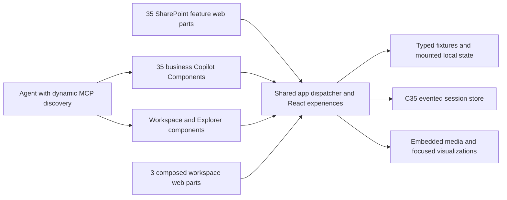
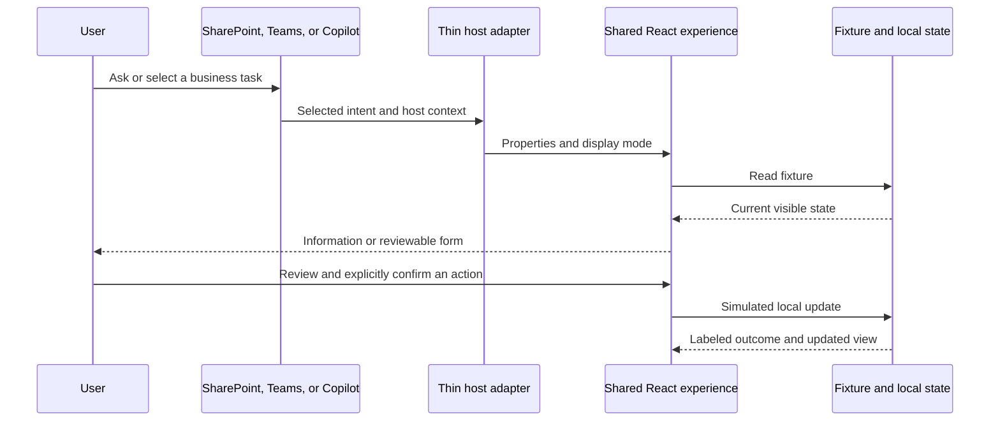

# Release readiness

This is the sharing and validation handoff for the fixture-first Zava One sample.
**Source baseline: SPFx 1.24.0 GA / React 18.3.1.** Presenter documentation was refreshed on
November 19, 2026; that is not a new package build, authenticated keynote rehearsal, or accessibility
certification. See [current progress and open gates](../todo.md#documentation-and-finalization---november-19-2026).
The November 23 documentation update also covers the separately maintained manual plug-in for
tenant deployment and Cowork; it does not extend the earlier SPFx/Teams evidence to that package.

## Presenter and developer handoff

| Need | Guide |
| --- | --- |
| Executive story with exact prompts, clicks, values, and timing cuts | [Five-minute keynote](../demos/keynote-5-minutes.md) |
| Architecture, actual routing trace, lifecycle, state, MCP, and evidence | [Ten-minute technical demo](../demos/technical-demo-10-minutes.md), including a five-minute cut |
| Broader employee/service story | [Business journey](../demos/business-journey.md) and [20-minute showcase](../demos/feature-showcase-20-minutes.md) |
| Every prompt/tool/component/intent/route, schema, and sibling exclusion | [Intent-to-component mapping](./intent-component-mapping.md) |
| Preflight, per-context reset, local/screenshot fallback, and recovery | [Demo operations](../demos/demo-operations.md) |
| Short cut and discussion companion | [Demo index](../demos/README.md) |
| Manual plug-in packaging, tenant deployment, and Cowork use | [zava-one-hub-plugin guide](../zava-one-hub-plugin/README.md) |

## Manual plug-in and Cowork deployment

[zava-one-hub-plugin](../zava-one-hub-plugin) contains the manually created plug-in version of the
agent. It has a distinct **Zava One Hub Plugin** app/agent identity and adds an app-level
`agentConnectors` MCP connector for plug-in consumers such as Cowork. Both that connector and the
included agent dynamically discover the existing SPFx tools.

This is separate from the [original agent definition](../copilot/manifest.json), the
[generated agent ZIP](../teams/zava-one.zip), and the three Teams personal-app ZIPs. The manual
plug-in contains configuration and icons, not the SPFx implementation; the SPPKG must remain
deployed and enabled in the same tenant targeted by both MCP URLs.

From the sample root, package it for the intended tenant:

```powershell
.\zava-one-hub-plugin\Package-Plugin.ps1 -TenantUrl 'https://yourtenant.sharepoint.com'
```

The helper rewrites both endpoint URLs and recreates the
[manual plug-in ZIP](../zava-one-hub-plugin/zava-one-hub-plugin.zip). The normal SPFx build and
release-evidence pipeline do not regenerate or audit this separate package. Use the tenant's
supported plug-in upload/deployment flow, assign test users/groups, and verify availability and tool
invocation in **Cowork**. Its `devPreview` app manifest and tenant policy require explicit acceptance;
packaging is not deployment or proof of Cowork compatibility. See the
[plug-in acceptance checklist](../zava-one-hub-plugin/README.md#validate-in-the-tenant-and-cowork).

## Architecture



There are **75 SPFx identities**, **37 source tools**, and two host-specific bundles.
The GA plugin dynamically discovers tools; its static `functions` array is empty.
Do not describe the 37 source tools as 37 statically embedded plugin functions.

## Data and action flow



This describes confirmed form/decision flows, not a universal review stage for every interaction.
Tasks uses local checkbox completion. C35 alone provides the shared vacation-decision store;
other forms primarily use mount-local state.

## Host matrix

| Surface | Count | Exposure | Evidence boundary |
| --- | ---: | --- | --- |
| Feature web parts | 35 | `SharePointWebPart` only | Earlier package/Workbench baseline; modern page acceptance remains open |
| Workspace web parts | 3 | SharePoint web part/full page; Teams host support | Three distributed Teams packages are personal-only, not channel apps |
| Business Copilot Components | 35 | Inline and host-approved full screen | Source contracts present; actual GA model routing/arguments need authenticated rehearsal |
| Workspace component | 1 | Composed workspace | Default Company; advertised `tab` is not currently consumed |
| Capability explorer | 1 | Inline scenario discovery | Full-screen expansion renders the Company workspace, not a full-screen Explorer |

The author previously confirmed the three Teams personal apps work and supplied three authenticated
screenshots. That is a historical baseline, not complete GA host acceptance.

## Demo contract and known limits

- Choose the narrowest primary tool. The [mapping](./intent-component-mapping.md) covers all 35
  business intents, both infrastructure entries, and all six starters.
- Tool schemas advertise filters/prefills, but several active React bodies do not consume them.
  Use the documented visible controls; never present seeded defaults as extracted prompt values.
- Full screen composes the owning tab's modules. It does not deep-link the selected record or transfer
  the inline draft/stage; finish the C35 confirmation inline before expanding.
- Sales Region changes the bookings series; Period changes its label only. Office local times use a
  fixed fixture instant. Several source/service launch buttons are presentation-only.
- C35 reset is 4 pending / 2 processed, including two seeded decisions. Johanna's confirmed approval
  produces `ZAVA-LEAVE-1043` and 3/3. Reset is scoped to the current runtime/browsing context.
- Session storage is not a cross-host/cross-tab service. Neither receipts nor layout persistence
  imply synchronized SharePoint, Teams, Copilot, or cross-device state.
- The local harness records bridge messages and has a no-op Expand callback. It cannot certify model
  routing, real host expansion, authentication, or follow-up answers.

## Privacy and safety

- Business data, people, prices, policies, and receipts are fictional fixtures.
- No runtime Graph, SharePoint, HR, finance, CRM, LMS, ITSM, market, or security provider is called.
- Form drafts remain local to the mounted experience; some confirmed updates persist in session
  storage. Do not enter real private information, secrets, or credentials.
- Review/confirmation is explicit for the demonstrated submission and decision flows. Prompt inputs
  do not authorize actions; a simulated receipt is not evidence of a source-system write.
- See [the state and reset boundary](../demos/demo-operations.md#deterministic-reset) before rehearsal.

## Accessibility evidence and limits

Recorded local checks cover semantic controls, visible focus, keyboard-capable layout movement,
text alternatives for selected charts/maps, light/dark tokens, and responsive layouts. The publication
gallery includes 12 local captures and three authenticated Teams viewport overviews. Teams crops
remove only the four-pixel window frame and verify retained pixels.

This is not accessibility certification. Authenticated checks remain required for Narrator/JAWS,
native 200% zoom, forced colors, reduced motion, iframe focus, Teams chrome, and modern SharePoint.
Do not infer screen-reader acceptance from screenshots or responsive-state totals.

## Evidence and validation

The committed [phase-6 matrix](../ux-review/evidence/phase-6-matrix.json) records:

| Recorded evidence | Value | How to interpret it |
| --- | --- | --- |
| Jest | 50 passed / zero failures | Recorded test result, not a test execution during this documentation refresh |
| Catalog | 35 pairs / 75 unique identities / 37 source tools / 6 starters | Validate source and discovered schemas separately from model selection |
| Media/bundles | 28 provenance-checked assets / 2 host-specific bundles | Offline content and host isolation |
| Screenshots | 39 engineering / 15 publication | Includes three historical authenticated Teams views |
| Responsive sweep | 4,080 states / zero recorded failures | A separate browser run, not automatically replayed by `build` |
| SPPKG | `1.0.0.18` / 110 entries | Artifact sizes and SHA-256 values are in the matrix's `artifacts` array |

**Evidence caveat:** the matrix mixes newer package/test results with historical host fields; its
`profile.spfx` still says `1.24.0-beta.5`. Use [package.json](../package.json) for the GA source
baseline. Hash parity proves artifact identity, not that those older host measurements certify GA.
Reconcile profile and host provenance during the next real clean-release evidence pass, not by
changing a timestamp or relabeling historical screenshots.

For documentation and source-routing checks:

```powershell
npm run check:routing-collisions
npm run check:publication
git diff --check
```

For a clean release, use a supported Node version (22.14+ in 22.x, 24.x, or 26.x), an approved
registry, and stop task-owned watchers first:

```powershell
npm ci
npm run build
```

`build` includes `validate`, clean production tests, packaging, generated-plugin/schema validation,
package audit, and evidence checks. Run `npm run check:responsive` against the running UX server
for fresh browser evidence. Capture/update procedures are in
[operations](../demos/demo-operations.md#evidence-and-handoff) and
[responsive review](./responsive-review.md).

## Sharing checklist

- Share the validated [SPPkg](../sharepoint/solution/zava-one-hub.sppkg) and
  [agent ZIP](../teams/zava-one.zip), with matching artifact evidence.
- For Cowork, separately package, deploy, and assign the
  [manual plug-in](../zava-one-hub-plugin/README.md). Check its target tenant, five-file archive,
  distinct identity, and authenticated Cowork invocation; it is not covered by the phase-6 matrix.
- Upload the three personal-app packages separately; see [Teams](../teams/README.md).
- Include [gallery metadata](../assets/sample.json), the
  [presenter set](../demos/README.md), and the [routing contract](./intent-component-mapping.md).
- Keep known limitations visible. Passing source/documentation checks does not close the
  [remaining release gates](../todo.md#remaining-release-gates).

## External and implementation gates

Before calling the keynote fully signed off: rehearse real GA model routing/arguments, C35 decisions,
expansion/collapse, news follow-up, and latency in the target tenant; reconcile unused input schemas
and exact draft/selection continuity; complete a clean restore/build/offline run; obtain presenter and
media approval. Track evidence and failures in [todo.md](../todo.md).

Before any production claim: validate host accessibility, CSP, identity/permissions, real provider
semantics, privacy/retention, telemetry, rollback, and service-owner approval. These are separate
from the offline demo deliverable.
For the manual plug-in, also record tenant upload acceptance, assignment, connector discovery, and
actual Cowork rendering separately from the original agent and Teams baselines.
